# Syncfusion Video Studio: User Guide

Video Studio turns a written description of a video into finished, platform-ready videos. You write the video as a Markdown **spec**, improve it with Claude, attach your footage, pick a brand and the platforms you want, and press **Run**. Claude Code then plans the edit, generates the voice-over and music, records apps if the spec asks for it, and has cutline render and check every output.

This guide covers the macOS app. Building it, signing it and the command-line tool are in [README.md](README.md).

**Contents**

1. [Before you start](#1-before-you-start)
2. [Quick start: your first video](#2-quick-start-your-first-video)
3. [Creating and opening projects](#3-creating-and-opening-projects)
4. [The project window](#4-the-project-window)
5. [Writing the spec](#5-writing-the-spec)
6. [Working with Claude](#6-working-with-claude)
7. [Media](#7-media)
8. [Brand presets](#8-brand-presets)
9. [Outputs and run configs](#9-outputs-and-run-configs)
10. [The Project inspector](#10-the-project-inspector)
11. [Validation](#11-validation)
12. [Running](#12-running)
13. [Results, revisions and logs](#13-results-revisions-and-logs)
14. [Recording apps during a run](#14-recording-apps-during-a-run)
15. [Voice-over and music](#15-voice-over-and-music)
16. [Settings reference](#16-settings-reference)
17. [Keyboard shortcuts](#17-keyboard-shortcuts)
18. [Where things are stored](#18-where-things-are-stored)
19. [Troubleshooting](#19-troubleshooting)

---

## 1. Before you start

| You need | Why | How |
|---|---|---|
| **Claude Code** 2.1.0 or later, signed in | Claude writes the edit and drives the run | Install it, then run `claude` in Terminal once and sign in. The app never asks for your Anthropic credentials. |
| **cutline** with its tools | Renders and checks the videos | Install cutline, then `cutline deps install --all` (ffmpeg, models, Chrome for HTML graphics), or click **Install Dependencies** in the app |
| **ElevenLabs API key** (optional) | Generated voice-over, music, sound effects, word timings | Settings › ElevenLabs › *Paste a new key* |
| **Cartesia API key** (optional) | Only if Cartesia should speak the voice-over | Settings › ElevenLabs › *Voice-over by: Cartesia* |

The first time you open the app, the **Welcome** window shows a **Setup** checklist with each of these, plus a brand preset and the output folder. A green row is ready; anything else has a link that fixes it.

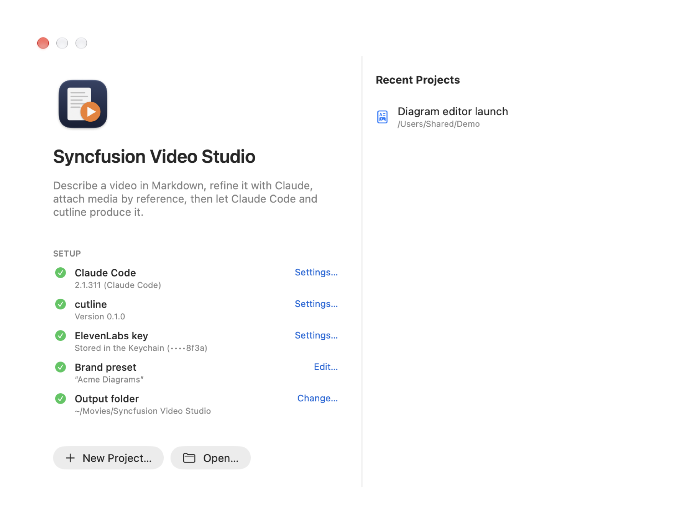

---

## 2. Quick start: your first video

This walkthrough takes a project from empty to finished videos. The example is a launch video for a made-up product, "Acme Diagrams", so every screenshot is from a real project. Plan on about 20 minutes, most of it waiting for the run. Each step links to the section with the details.

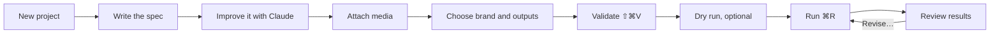

### Step 1: Check the setup

Open Video Studio. In the Welcome window, every row under **Setup** should have a green tick: Claude Code, cutline and, if you want generated voice-over, your ElevenLabs key. Fix any row that isn't green with the link beside it. [Before you start](#1-before-you-start) explains each one.

### Step 2: Create the project

Choose **New Project…** (⌘N). Name the project, pick the **intent** that matches the video (here *Product demo*) and a spec template, then choose **Create…** and save the file anywhere you like.

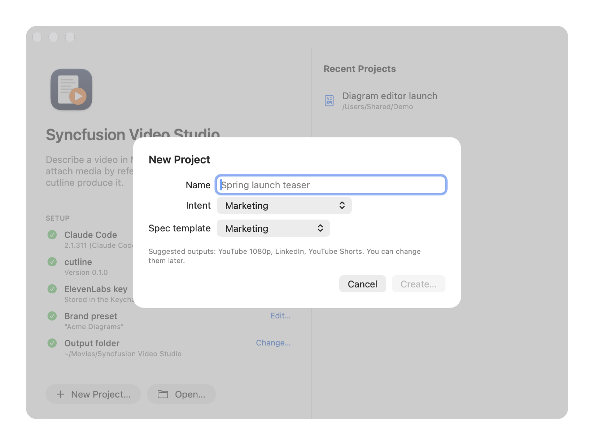

### Step 3: Write the spec

The project opens with a template for its intent. Replace the placeholders with your own scenes: how long each one lasts, what is on screen, and what the narrator says. The outline on the left lists the scenes, and the status bar at the bottom warns about problems as you type.

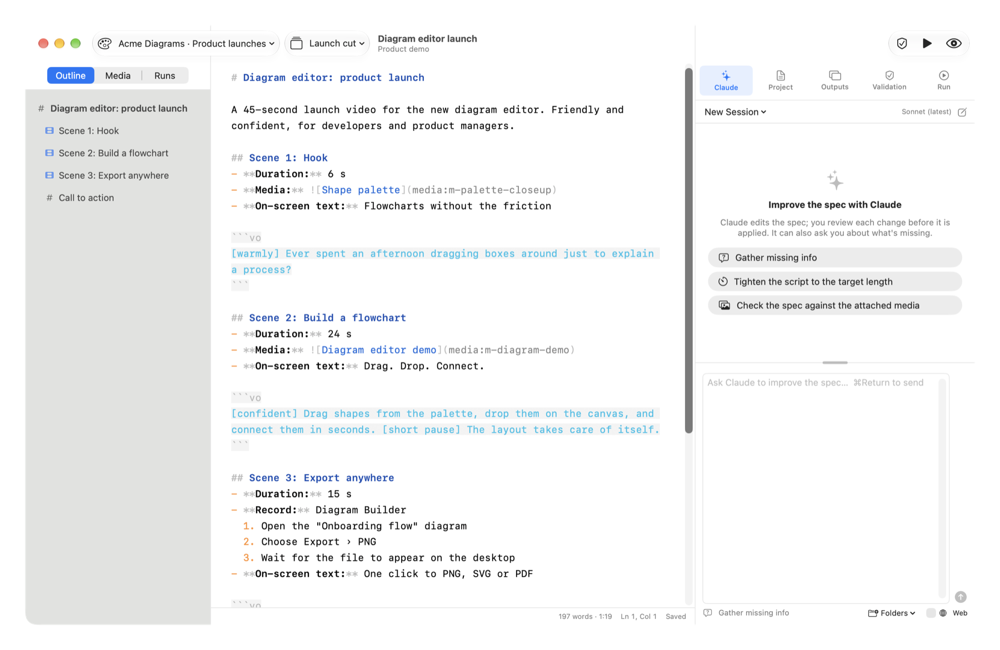

To add a scene, a voice-over, a shot or a music brief, type **/** on an empty line and choose from the list, instead of typing the structure by hand.

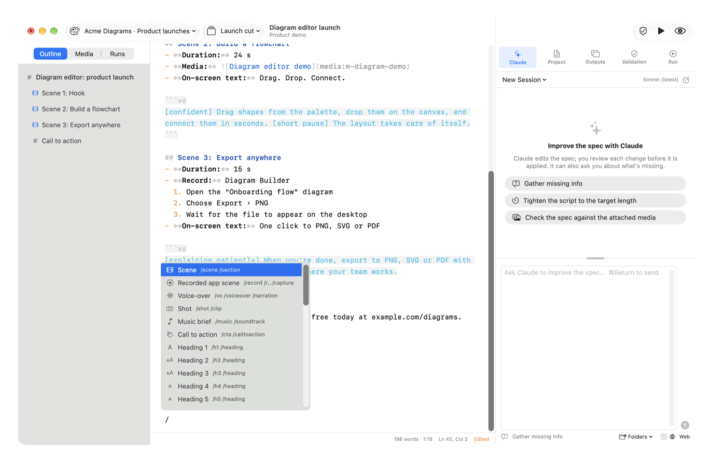

More in [Writing the spec](#5-writing-the-spec).

### Step 4: Improve it with Claude

Open the **Claude** tab and say what you want in plain words, for example "Make the hook shorter and punchier." Claude may ask a question first:

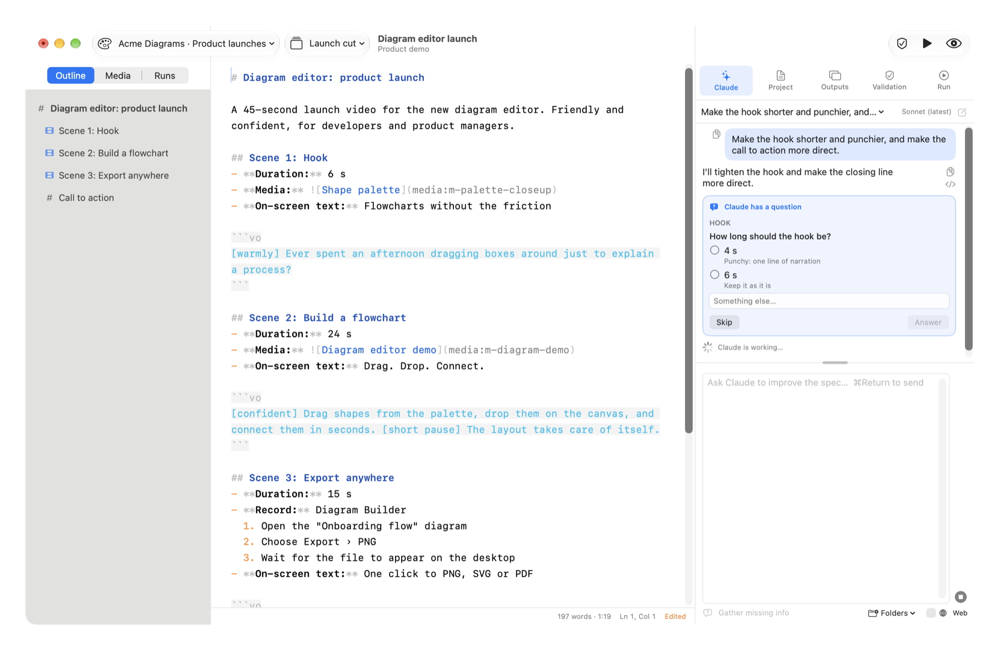

Then it proposes changes. Nothing in your spec changes until you accept it:

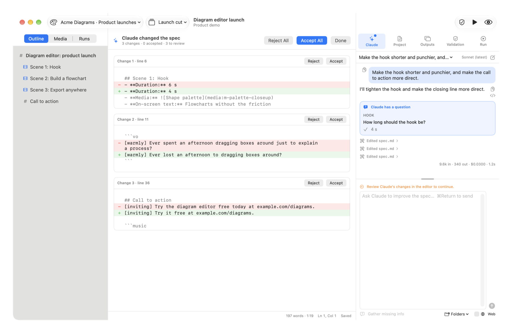

Choose **Accept All**, or accept and reject each change and then choose **Done**. More in [Working with Claude](#6-working-with-claude).

### Step 5: Add your media

Drag video, audio and images onto the editor or the **Media** sidebar. Files are used where they are; nothing is copied. Each one gets an ID such as `m-diagram-demo`, which the spec uses to refer to it.

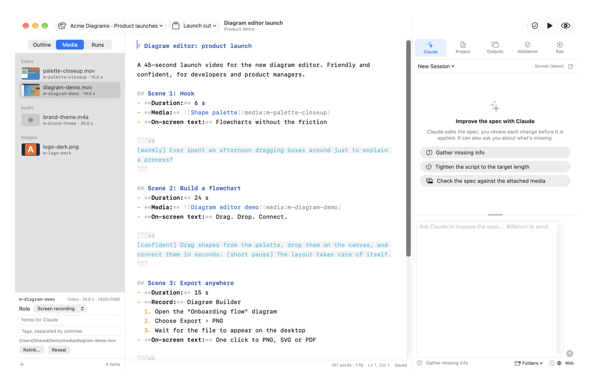

If you have no footage of an app for a scene, write a `Record:` line and the run records it for you. See [Recording apps during a run](#14-recording-apps-during-a-run).

### Step 6: Choose the brand and the outputs

In the toolbar, pick a **brand preset** and tick the instruction sets that apply to this video. Then open the **Outputs** tab and tick the platforms you want. Each one becomes its own video, with the right shape, captions and length limits.

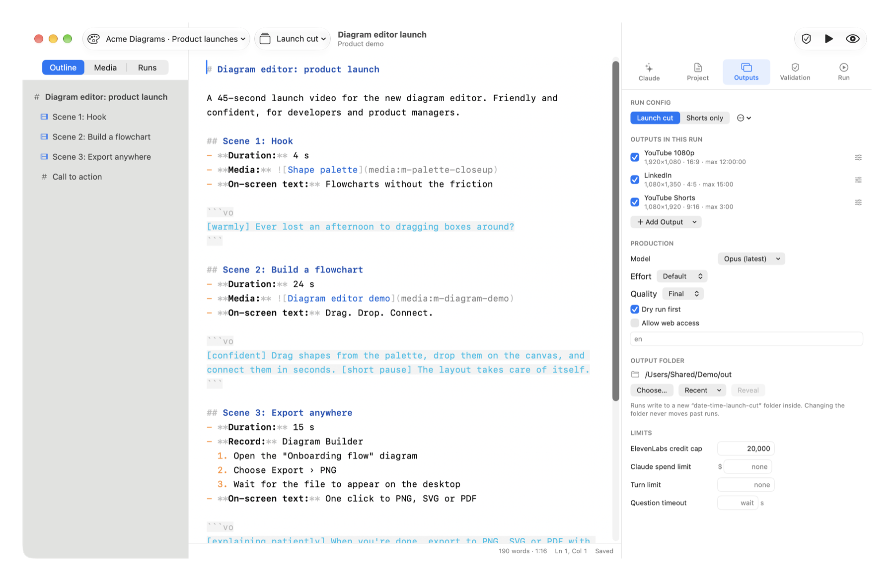

More in [Brand presets](#8-brand-presets) and [Outputs and run configs](#9-outputs-and-run-configs).

### Step 7: Validate

Press **Validate** (⇧⌘V). It checks the spec, the media, the brand and the outputs without calling any model, so it costs nothing. Fix the **blockers** first: each finding links to where it can be fixed, or choose **Ask Claude to Fix**.

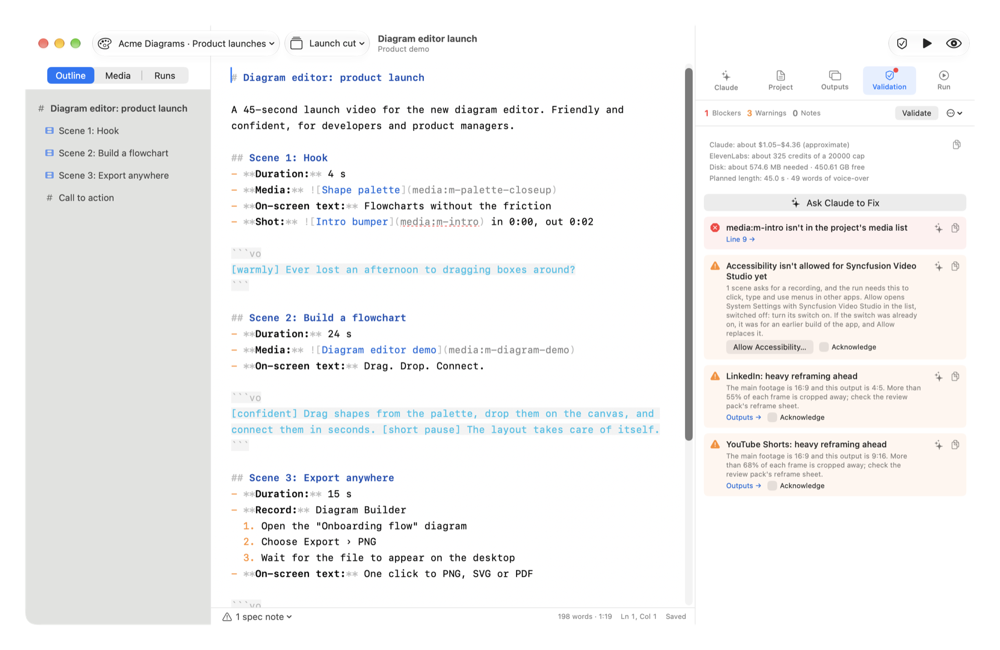

### Step 8: Run

Press **Run** (⌘R). A sheet shows what will be made and roughly what it will cost. With *Do a dry run first* ticked, a cheaper model rehearses the plan before the production run.

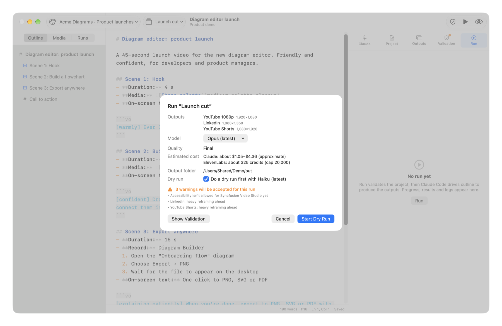

While the run works, the **Run** tab shows each stage and the cost so far.

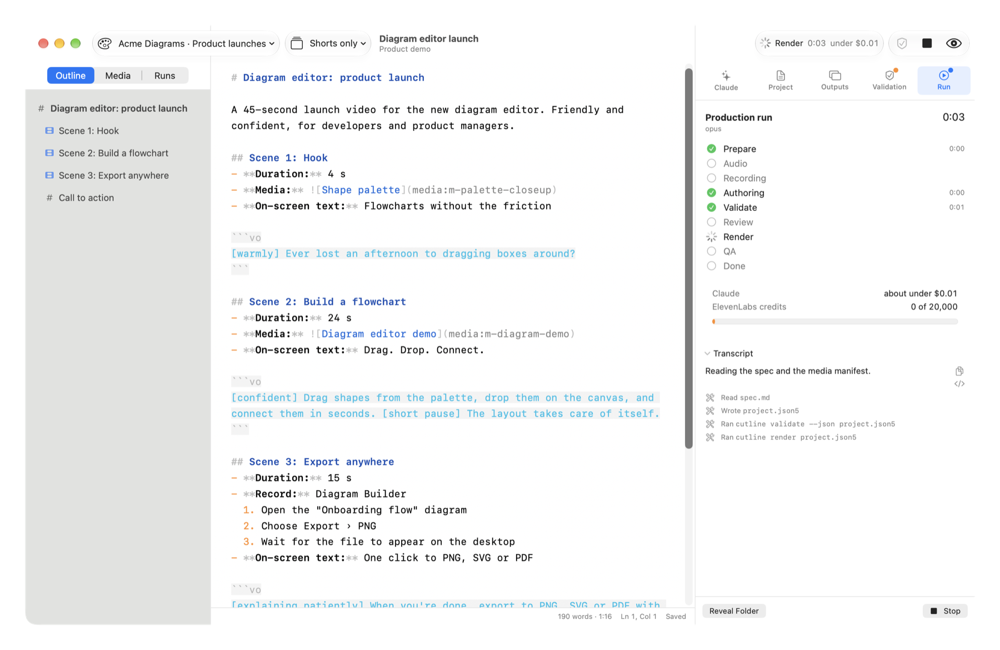

If Claude needs a decision, a question card appears. Answer it, or the run waits.

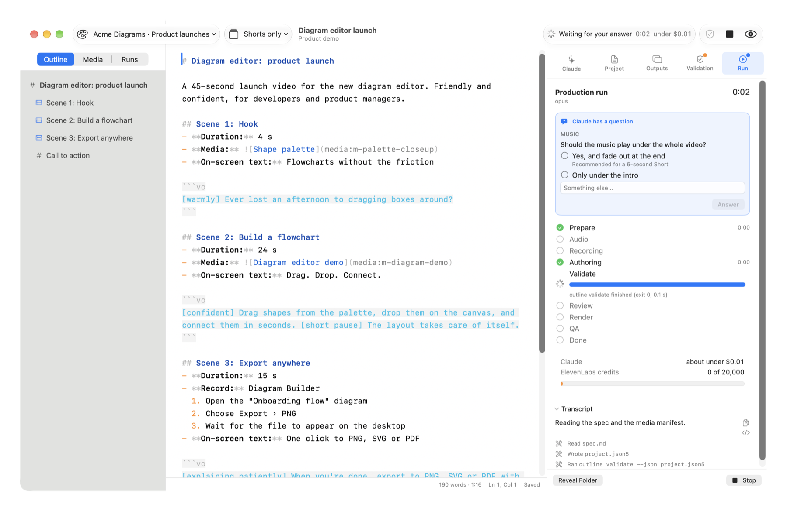

Press **Stop** (⌘.) at any time; partial outputs and logs are kept. More in [Running](#12-running).

### Step 9: Review the result

When the run ends, the **Run** tab shows each video with its QA verdict. Play it, reveal it in Finder or copy its path.

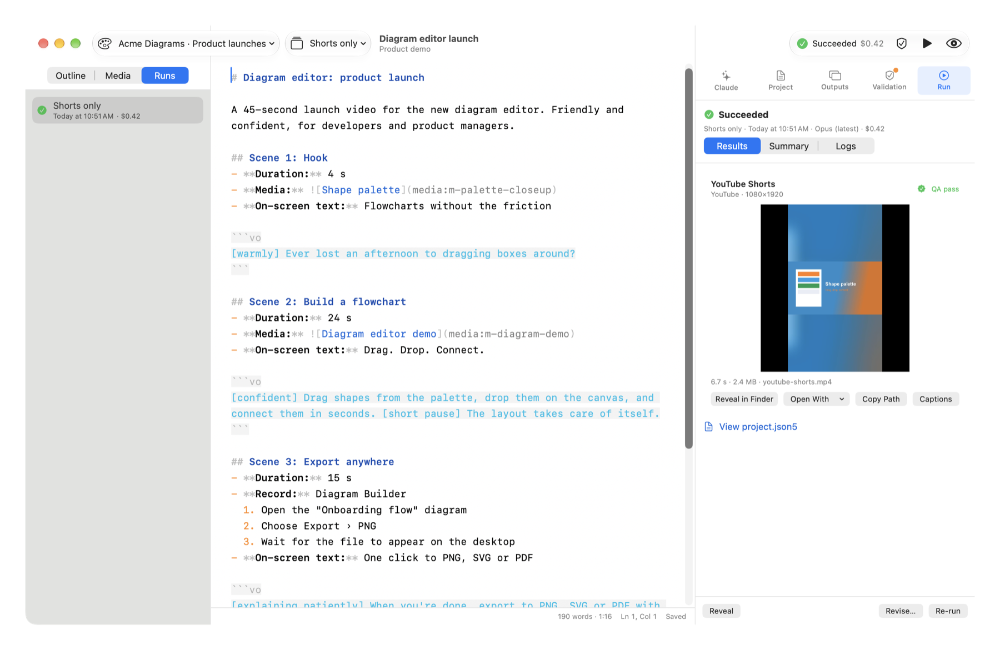

Not quite right? Choose **Revise…**, say what to change ("make the intro shorter"), and Claude continues from that run. More in [Results, revisions and logs](#13-results-revisions-and-logs).

### Where to go next

- Set up your brand and platforms: [Brand presets](#8-brand-presets), [Outputs and run configs](#9-outputs-and-run-configs).
- Choose a voice and music: [Voice-over and music](#15-voice-over-and-music).
- Something not working: [Troubleshooting](#19-troubleshooting).

---

## 3. Creating and opening projects

### New project (⌘N)


The **New Project** sheet asks for:

- **Name**, for example "Spring launch teaser".
- **Intent**, what kind of video this is: Marketing, Product demo, Tutorial or how-to, Explainer, Social clip, Testimonial, Announcement, Event recap, Internal communication, App store preview, or Other (then *Describe it*). The intent sets defaults for pacing, captions and music. Claude is told the intent, and it also suggests outputs (for example Marketing → YouTube 1080p, LinkedIn, YouTube Shorts).
- **Spec template**, a starting spec for that intent. Your own templates appear here too (see *Save As Template…* below).

**Create…** asks where to save. A project is a single `.cutproj` file; media stays where it is.

### Opening and other file commands

- **File › Open…** (⌘O), **Open Recent**, or the **Recent Projects** list in the Welcome window. You can open several projects at once; each gets its own window.
- The app reopens the projects you had open when you quit.
- **File › Duplicate…** copies the project. **Save As…** (⇧⌘S) saves it under a new name.
- **File › Save As Template…** turns the current spec into a template offered for new projects.
- **File › Export Spec…** (⇧⌘E) saves the spec as a Markdown file.
- Projects **autosave** one second after you stop typing. The status bar shows *Edited* or *Saved*.

---

## 4. The project window


Switch the sidebar with ⌃⌘1, ⌃⌘2 and ⌃⌘3, and the inspector with ⌥⌘1 to ⌥⌘5.

**Toolbar**, left to right:

- **Brand menu.** Pick a brand preset and the instruction sets this project uses.
- **Run config menu.** Pick which set of outputs and limits the next run uses.
- **Run status.** While a run is going, its stage, elapsed time and cost so far; otherwise the last run's result.
- **Validate**, **Run** (it becomes **Stop** during a run), and **Preview/Source**.

**Sidebar:**

- **Outline** lists the spec's headings. Scenes get a film icon, and a warning triangle marks lines with a problem. Click a row to jump to it.
- **Media** lists the project's files (see [Media](#7-media)).
- **Runs** lists past runs, newest first (see [Results](#13-results-revisions-and-logs)).

**Inspector tab badges:** Validation shows a red dot for blockers or an orange dot for warnings. Run shows a dot while Claude is waiting for an answer. Claude shows a dot while changes are waiting for review.

**Status bar:** *N spec notes* lists live problems in the spec, and clicking one jumps to its line. It also shows the word count and estimated spoken length (at the reading speed in Settings › General), and the cursor position.

---

## 5. Writing the spec

The spec is ordinary Markdown with a few conventions Video Studio understands. You can write it freely; the conventions let the app check timing and let Claude build the edit precisely.

### Spec blocks

Type `/` at the start of a line (or after a space) to open the command list. Type to filter, use ↑/↓, and press Return or Tab to choose. The same blocks are in **Format › Insert …**. After inserting, the first `{{placeholder}}` is selected so you can type over it.

| Command | Inserts |
|---|---|
| `/scene` | A scene heading with Duration, Media and On-screen text fields, and a voice-over block |
| `/record` | A scene recorded from an app during the run: a `Record:` line and numbered steps |
| `/vo` | A voice-over block |
| `/shot` | A shot line: which media, in and out points, notes |
| `/music` | A music brief: mood, tempo, length, source |
| `/cta` | A *Call to action* section |


A complete scene looks like this:

````markdown
## Scene 2: Build a flowchart

- **Duration:** 12 s
- **Media:** 
- **Shot:**  in 0:14, out 0:26 — zoom on the palette
- **On-screen text:** Drag, drop, connect

```vo
[warmly] Drag shapes from the palette, drop them on the canvas, and connect them in seconds.
```
````

### What the app understands

- **Scenes.** Any heading that starts with "Scene" (`## Scene 1: Hook`, `### Scene - Intro`). A scene runs until the next heading of the same or higher level.
- **Field lines** have the form `- **Key:** value`. The keys the app reads:

| Key (and synonyms) | Meaning |
|---|---|
| `Duration` / `Length` | Scene length: `5 s`, `45 seconds`, `0:30`, `1m 20s`, `2 min`, `~8 s` |
| `Media` / `Shot` / `Footage` / `B-roll` | Footage for the scene, usually a `media:` reference |
| `VO` / `Voice-over` / `Narration` | Short inline voice-over |
| `On-screen text` / `Text` / `Caption` / `Title` | Text drawn on the video |
| `CTA` / `Call to action` | The call to action |
| `Record` / `Recording` / `Capture` | An app or web page to record during the run (see [Recording apps](#14-recording-apps-during-a-run)) |

- **Voice-over** goes in fenced blocks tagged `vo`. The app counts the words to check that each scene's narration fits its duration.
- **Music** goes in a fenced block tagged `music` with `mood`, `tempo`, `length` and `source` (`generated`, or `media:<id>` for your own track).
- **Call to action** is a heading containing "Call to action" or "CTA", a `cta` block, or a `CTA:` field.
- **Media references** look like ``. Dropping a file inserts one for you.
- **Placeholders** `{{…}}`, and words like TODO, TBD or lorem ipsum, are flagged until replaced.
- Transitions, beat cuts and music fades don't belong in the spec. They come from [Finish settings](#finish), though the spec can ask for something different.

### Live spec notes

As you type, the app checks the spec and lists problems in the status bar and the Outline:

- a `media:` reference that isn't in the project;
- an empty scene (no media, narration or on-screen text);
- narration too long for its scene, or for the whole video's target length;
- scene durations that add up to more than 20% away from the target length;
- leftover placeholders.

### Editing conveniences

- **Formatting:** Bold ⌘B, Italic ⌘I, Strikethrough ⇧⌘X, Inline code ⌘E, Link ⌘K, Headings ⌘1–⌘6 (⌘0 back to a paragraph), Numbered/Bulleted/Task list ⇧⌘7/8/9, Quote ⇧⌘., Code block ⌥⌘C, Indent/Outdent ⌘]/⌘[, Move line ⌥⌘↑/↓. These shortcuts work while the spec editor has focus; everything is also in the Format menu. The `/` list also has `/h1`–`/h6`, `/todo`, `/table`, `/mermaid`, `/math`, `/note`, `/tip`, `/warning`, `/details`, `/toc`, `/date` and more.
- **Lists:** Return continues a list; Tab and Shift-Tab indent and outdent. Typing `@td: text` then Return makes a task item.
- **Tables:** `/table`, or `@t:3,4` then Tab for 3 rows × 4 columns.
  - A toolbar floats over the table you're in: insert or delete rows and columns, move them, set alignment, format.
  - Right-click › Table has *Edit Table…* (a spreadsheet view), sorting and *Copy Table as CSV*.
  - Tab moves between cells.
  - Pasting CSV, TSV or an HTML table offers to convert it.
- **Images:** pasting an image with no file behind it (a screenshot, say) stores it next to the project in `<name>.cutproj.assets/`. **File › Clean Up Pasted Images…** removes the ones no longer used. Right-click an image for *Set Width…*. Rich text pasted from a browser, Teams or Outlook becomes Markdown.
- **Find and replace:** ⌘F, ⌥⌘F, ⌘G and ⇧⌘G, with match case, whole word and regular expressions (`$1` for groups).
- **Preview** (⌘/) shows the rendered spec. **View › Show Images and Diagrams Inline** draws images, Mermaid diagrams and math under their source while you edit.

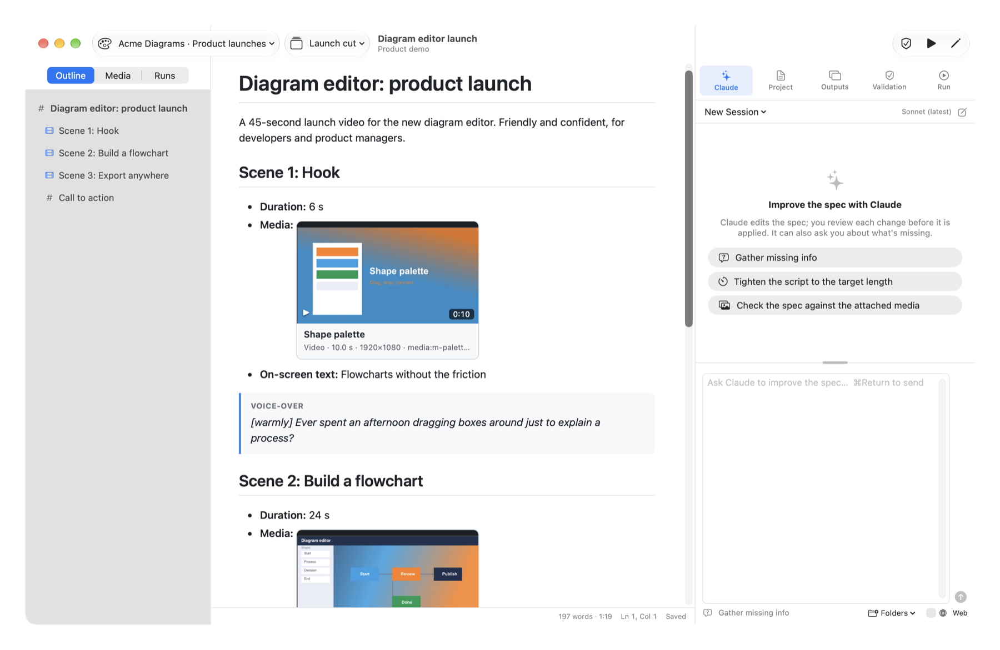

### Islands: named regions for Claude

An island marks part of the spec with a name, so you can point Claude at it:

```markdown
<!-- island: hook -->
## Scene 1: Hook
...
<!-- /island: hook -->
```

- Select lines, then use **Format › Insert Island** or right-click › *Wrap in Island*.
- Mention `@hook` in a message to Claude to mean that region. Right-click an island for *Ask Claude…*, *Copy Reference*, *Rename*, *Unwrap* or *Delete*.
- Names use lowercase letters, digits and dashes. Islands can't be nested. When markers are broken, the app offers quick fixes.

---

## 6. Working with Claude

The **Claude** tab (⌥⌘1) is a chat with a spec assistant. Claude works on a copy of the spec, and each change comes back to you for approval. It can read your attached media notes and ask you questions.

### Starting points

On an empty chat you'll see three suggestions:

- **Gather missing info** (⌃⌘G). Claude reads the spec, interviews you a few questions at a time about what's missing (audience, length, key message…), then writes the answers in.
- **Tighten the script to the target length.**
- **Check the spec against the attached media.**

### The message box

- Type a request and press **⌘Return** to send. Return adds a new line.
- **Selection, lines a–b**, when ticked, sends the text you've selected along as context.
- **Validation findings (N)**, when ticked (the default), sends what validation found, so you can just say "fix these".
- **Folders** adds read-only reference folders Claude may read, such as product docs or an earlier script.
- **Web** lets Claude search and read the web for this conversation.
- Other ways to start a conversation: right-click › *Ask Claude About Selection…*, an island's *Ask Claude…*, or **Ask Claude to Fix** in the Validation tab.

### Reviewing Claude's changes

When Claude edits the spec, the editor switches to a review titled **"Claude changed the spec"**:

- Each change is a card showing removed and added lines, with **Accept** and **Reject**.
- **Accept All**, **Reject All** and **Done** decide everything at once. *Done* keeps what you accepted and the original text for the rest.
- The result is a single undo step (⌘Z reverts all of it).
- You can't send another message until the review is finished.


### Questions from Claude

When Claude needs a decision, a **"Claude has a question"** card appears. Pick an option or type your own answer in *Something else…*, then **Answer**, or **Skip** to let Claude use its judgment.


### Sessions and models

- The menu at the top of the panel switches between conversations, starts a **New Session** (⇧⌘N), and renames or deletes them.
- The assistant's model is set in **Project › Models › Spec assistant**. The default comes from Settings › Claude and is Sonnet.
- To see each reply's token usage and cost, turn on Settings › Claude › *Show token usage and cost after each assistant reply*.

---

## 7. Media

Media is **used by reference**: files stay where they are and nothing is copied into the project.

### Adding media

- Drop files on the **editor** (inserts a reference at that point) or on the **Media sidebar**.
- **File › Add Media…** (⇧⌘I) adds files or folders.
- **File › Add Media Folder…** adds a whole folder, optionally only video, audio or images.
- Each file gets an ID from its name, such as `m-hero` or `m-hero-2`, used as ``.

### The Media sidebar

- Files are grouped by kind (Video, Audio, Images, Fonts, Transcripts, Terminal tapes, Demo scripts, Other). Each row shows a thumbnail, the ID and the duration.
- A red **Missing** badge means the file can't be found. An orange **Changed** badge means it was modified since you added it.
- Drag a row into the spec to reference it.
- Right-click a row for *Insert in Spec*, *Copy Reference*, *Reveal in Finder*, *Quick Look*, *Relink…*, *Accept Changed File* or *Remove from Project*.
- Selecting a file shows its detail pane:
  - **Role:** Footage, B-roll, Screen recording, Logo, Music, Sound effect, Voice or Reference. It's guessed from the file name; correct it if needed.
  - **Notes for Claude:** for example, "the first 10 s are a loading screen, skip them".
  - **Tags.**


### When files move: relinking

When a file isn't where it was, the app looks for it in this order: the macOS bookmark, the path relative to the project, the original absolute path, then your **media search folders**. A file it finds elsewhere is updated silently.

If anything is still missing when a project opens, the **Relink Media** sheet appears. You can also open it with **File › Relink Media…** or the *N missing — Relink…* button.

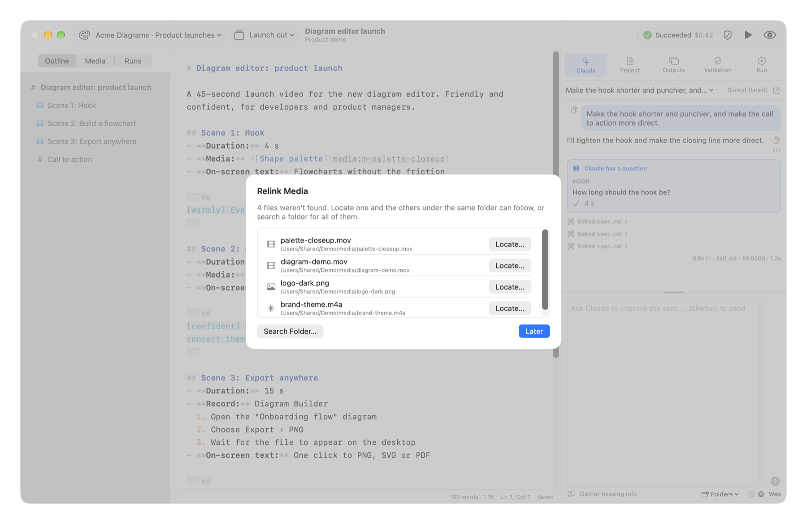

- **Locate…** points to one file. The app then offers to relink the others that moved the same way (*Apply Prefix Fix*), which is handy when a whole folder moved or the project came from another Mac.
- **Search Folder…** finds missing files in a folder, by name and then by content.

Add folders where your media usually lives under Settings › General › *Media search folders* (all projects) or Project › *Media search folders* (this project).

---

## 8. Brand presets

A brand preset holds the look and rules every video for that brand follows. Open the **App Library** (⇧⌘L, or **Edit Brand Presets…** in the toolbar's brand menu), then **Brand Presets**.

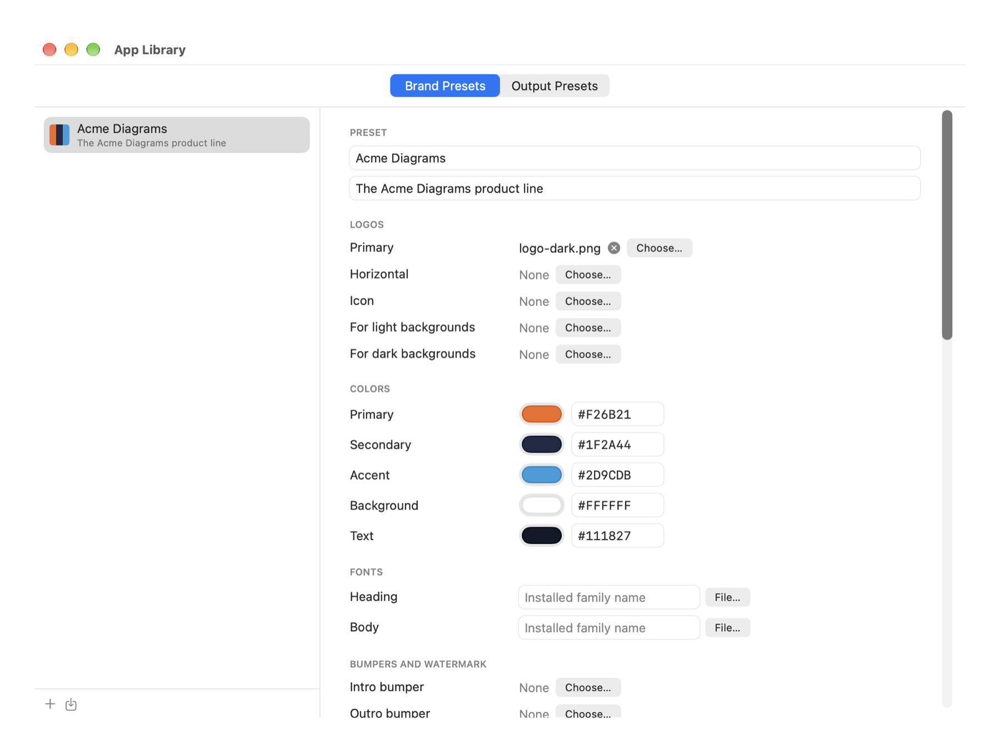

| Section | Fields | Notes |
|---|---|---|
| **Preset** | Name, Description | |
| **Logos** | Primary, Horizontal, Icon, For light backgrounds, For dark backgrounds | Referenced where they are, not copied. A missing file shows in red. |
| **Colors** | Primary, Secondary, Accent, Background, Text | Colour well or `#RRGGBB` |
| **Fonts** | Heading, Body | cutline can draw **Anton, Bebas Neue, Inter, Poppins and Source Serif 4** (Poppins Bold and ExtraBold, and Source Serif 4 Italic and Bold, included). Any other font is drawn as Inter, and the run says so. |
| **Bumpers and watermark** | Intro bumper, Outro bumper, Watermark position (default bottom right), Watermark opacity (default 60%) | The watermark is drawn from the brand logo |
| **Style** | Lower-third style, Caption style, Music mood | Caption styles cutline knows: `bold_pop`, `karaoke`, `word_by_word`, `clean_sentence`, `boxed` |
| **Voice** | Voice ID (ElevenLabs), Cartesia voice ID, Voice name, Model (default `eleven_v4`), Settings (JSON, e.g. `{"stability": 0.5}`) | See [Voice-over](#15-voice-over-and-music) |
| **Rules** | Free text | Do's and don'ts in your own words. Claude gets them word for word, for every project. |
| **Instructions** | Labelled instruction sets | See below |

Edits save automatically. **Export…** writes a `.cutbrand` file containing the preset and its assets; double-clicking one, or the import button, adds it to someone else's library. **Duplicate** and **Delete Preset** are at the bottom.

### Instruction sets

A brand often covers several product lines or audiences. Instead of one long rule list, add **instruction sets**: each has a **Label** (for example "Bold Reports") and text such as product facts, terminology and messaging. Choose **Add Instructions** to create one.

Each project picks which sets apply, in the toolbar's brand menu under *Instructions for this project*. The toolbar then shows "Brand · Label +N". Claude gets the chosen sets word for word, both while helping with the spec and while making the video. New projects start with none selected.

### Projects keep a snapshot

When you choose a brand for a project, the project stores a copy. Later edits to the preset don't change existing projects until you choose **Update "Brand" to Latest** in the brand menu; validation notes when an update is available. This keeps old projects reproducible.

To create a starter brand, use **Create Default** in the Welcome window's Setup list.

---

## 9. Outputs and run configs

### Output presets

In **App Library › Output Presets** you'll find built-in presets for common platforms. Each knows its shapes, caption style and limits:

| Preset | Shapes | Captions | Length limit |
|---|---|---|---|
| YouTube 1080p | 16:9 | sidecar files | 12 h |
| YouTube 4K | 4K 16:9 | sidecar files | 12 h |
| YouTube Shorts | 9:16 | burned in | 180 s |
| TikTok | 9:16 | burned in | 600 s |
| Instagram Reels | 9:16 | burned in | 90 s |
| Instagram Feed | 4:5, 1:1 | burned in | 3–3600 s |
| LinkedIn | 4:5, 16:9, 1:1 | burned in | 3–900 s, 5 GB |
| X / Twitter | 16:9, 1:1 | burned in | 140 s, 512 MB |
| Facebook | 16:9, 1:1, 4:5 | burned in | 4 h |
| Apple App Store preview | device sizes (e.g. 886×1920) | none | 15–30 s, 30 fps, 500 MB |
| Google Play promo | 16:9 | sidecar files | 30–120 s |
| Website hero loop | 16:9, 1:1, custom | none, no audio, loops | 30 s, 8 MB, MP4 + WebM |
| Custom | any | burned in | none |

Built-in presets can't be edited. **Duplicate…** one to make your own. Its fields are Name, Platform, Shapes (the first one ticked is the default), Captions (*Burned in*, *Sidecar files only* or *None*), Audio, Seamless loop, minimum and maximum length, size limit, maximum frame rate, and notes.

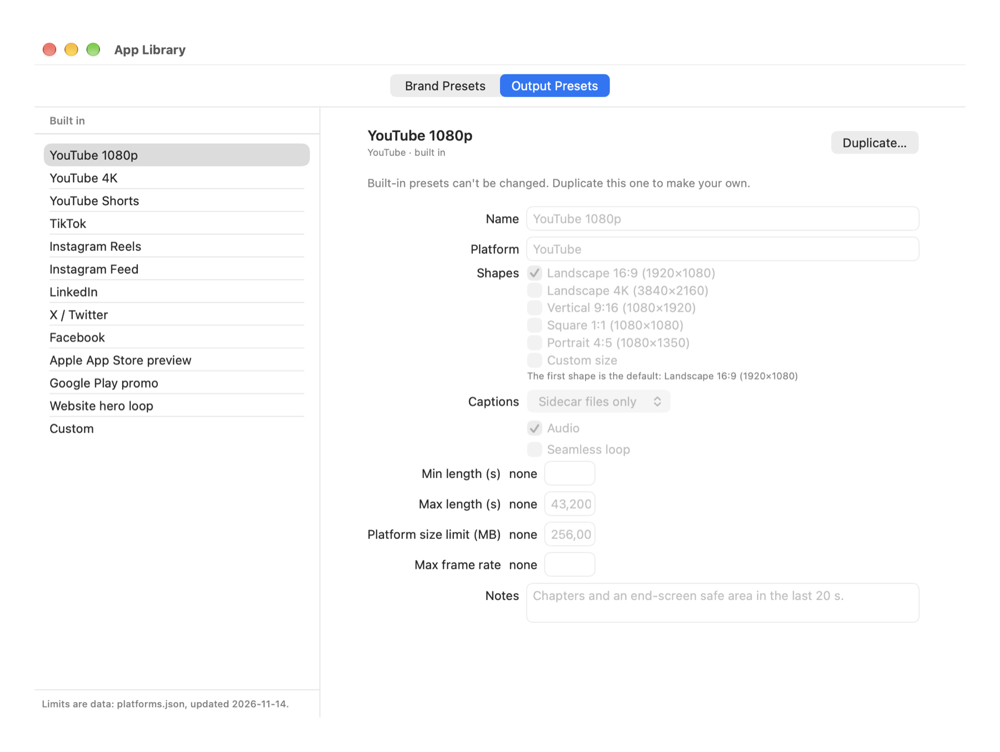

### Run configs

A **run config** is a named recipe for a run: which outputs, which model, and what limits. A project can have several, such as "Social cut" and "YouTube full". Choose one from the toolbar, and edit them in the **Outputs** tab (⌥⌘3).


- **Run config:** switch between configs. The ⋯ menu has *New Run Config…*, *Duplicate*, *Rename…* and *Delete*. Past runs stay in the history after you delete a config.
- **Outputs in this run:** tick the outputs to make. The slider icon edits one: shape, device size, custom size, frame rate, captions, audio, loop, maximum length, size cap, and formats (MP4/WebM). **Add Output** adds one from a preset.
- **Production:**
  - **Model** (default Opus) and **Effort**.
  - **Quality:** *Final*, or *Draft* for faster, lighter renders.
  - **Dry run first:** on by default.
  - **Allow web access:** lets Claude search the web during the run.
  - **Languages.**
- **Output folder:** where run folders go. The default is `~/Movies/Syncfusion Video Studio`. Each run writes a new `date-time-<config>` folder inside it.
- **Limits:**
  - **ElevenLabs credit cap:** default 20,000 per run.
  - **Claude spend limit** in $: the run stops if it's reached.
  - **Turn limit:** the maximum number of Claude turns.
  - **Question timeout:** how long to wait for your answer before Claude carries on with its stated assumption. Empty means wait.

New run configs take their model, credit cap, quality and web access from Settings.

---

## 10. The Project inspector

The **Project** tab (⌥⌘2) holds everything about this video that isn't the spec itself.

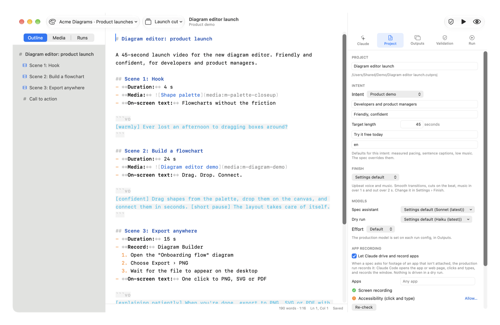

- **Project:** name and file location.
- **Intent** (required): the video type. Also:
  - **Audience** ("Who is this for?").
  - **Tone** ("Confident, friendly, technical, playful…").
  - **Target length** in seconds. It drives the timing checks.
  - **Call to action** ("Start a free trial").
  - **Languages**, as codes such as `en, de, ja`, base language first.

  A note shows the defaults the intent brings (pacing, captions, music). The spec can override them.
- **Finish:** *Settings default*, or *This project's own* to override [Finish settings](#finish) for this project only.
- **Models:**
  - **Spec assistant** and **Dry run** models.
  - **Effort**, if your Claude Code supports it. It applies to the assistant, dry runs, and production runs whose run config leaves Effort at its default.
  - The production model is set per run config, in Outputs.
- **App recording:** whether runs may drive and record apps, and which ones. See [Recording apps](#14-recording-apps-during-a-run).
- **Media search folders** for this project.

---

## 11. Validation

**Validate** (⇧⌘V, the toolbar, or Project › Validate) checks everything a run depends on, without calling any model and at no cost. **Run** always validates first.


The **Validation** tab (⌥⌘4) groups findings:

- **Blockers** (red) must be fixed before a run. For example:
  - Claude Code or cutline missing or signed out.
  - No ElevenLabs key when the spec needs generated audio.
  - Not enough credits.
  - Missing or unreadable media.
  - An empty spec, or no intent set.
  - A `media:` reference that doesn't exist.
  - A missing brand asset or an invalid colour.
  - No outputs selected.
  - A target length outside a platform's limits.
  - An output folder that can't be written, or not enough disk space.
  - An estimate over the run's ElevenLabs cap, or the run's minimum cost over its Claude spend limit.
- **Warnings** (orange) can be accepted. For example:
  - Changed or low-resolution media.
  - Narration too long.
  - Placeholders or empty scenes.
  - No call to action (for intents that need one).
  - No voice chosen.
  - App recording asked for while it's off, or not permitted.
  - Low text or logo contrast in the brand.
  - Output size or aspect concerns.
  - Tight disk space.
  - A spend limit that may be reached.
- **Notes** (grey) are for information, such as:
  - Optional cutline tools missing.
  - Variable frame rate or rotated footage.
  - No target length set.
  - The spec asks for burned-in captions but some outputs don't burn them in.
  - The spec asks for a watermark but the brand has none.
  - No brand selected.
  - A dry-run model that isn't cheaper than the production model.

Each finding has a link to where it's fixed (*Line N →*, *Media →*, *Brand →*, *Outputs →*, *Project →*, *Settings →*) or a one-click fix such as *Allow Screen Recording…* or *Update to Latest*. On warnings, tick **Acknowledge** to accept them for the next run.

**Ask Claude to Fix** opens the Claude tab with a request covering all findings, which you can edit before sending. The ✨ button on a single finding does the same for that one.

The **Estimates** box shows the approximate Claude cost range, the ElevenLabs credits against the cap, the disk space needed, and the planned length. Once a project has runs of the same kind and model, the estimate is based on what they cost.

---

## 12. Running

### Starting a run

Press **Run** (⌘R). The app validates, and if there are blockers it shows them in the Validation tab instead of starting. Otherwise a confirmation sheet shows:

- the outputs and their sizes;
- the **model**, which you can change for this run only;
- the quality;
- the **estimated cost** (Claude dollars, ElevenLabs credits against the cap);
- the output folder;
- **Do a dry run first**;
- any warnings that will be accepted.

Choose **Run** (or **Start Dry Run**) to begin.


### The dry run

A dry run uses a cheaper model (Haiku by default) to plan the whole edit without recording, generating audio or rendering finals. Files that the production run will make are replaced by stand-ins of the right length, so cutline can check timing, text layout, captions against the watermark, and each output's framing.

- If the dry run finds nothing, production starts automatically.
- Otherwise the sheet **"The dry run found points to look at"** lists:
  - what's *Unclear in the spec*;
  - *Missing media*;
  - *Risks*;
  - *Assumptions the dry run made*;
  - what's *Made during the production run (nothing to do)*.

  Choose **Ask Claude to Fix the Spec**, **Stop Here**, or **Run Anyway**.
- You can run a dry run on its own from Project › Dry Run (⌥⌘R) or the Validation tab's ⋯ menu › *Dry Run…*.

### While it runs


The **Run** tab (⌥⌘5) shows:

- **Stages:** Prepare → Audio → Recording → Authoring → Validate → Review → Render → QA → Done, each with progress.
- **Cost:** Claude's cost so far, and ElevenLabs credits used against the cap.
- **Warnings** as they arise, and a **Transcript** of what Claude is doing. Failed steps show in orange; Claude usually retries them.
- **Reveal Folder** and **Stop**.

**Questions.** When Claude needs a decision mid-run, a **"Claude has a question"** card appears in the Run tab. The app also sends a notification and puts a badge on the Dock icon. Choose or type an answer and press **Answer**. If the run config has a question timeout, Claude proceeds on its stated assumption once the timeout passes.


**Stopping.** **Stop** (⌘.) interrupts Claude, then after 5 seconds stops everything it started. Partial outputs and logs are kept. A run also ends if it reaches its Claude spend limit or turn limit.

**Several runs.** One project runs one thing at a time. Runs of different projects can go side by side, up to Settings › General › *Runs at the same time*.

---

## 13. Results, revisions and logs

When a run ends, the Run tab shows its status (*Succeeded*, *Succeeded with warnings*, *Failed* or *Cancelled*), its config, date, model, cost and credits, in three tabs.


- **Results:** a card per output with a player and the **QA verdict** (pass, warnings or fail, with details). Each card has *Reveal in Finder*, *Open With*, *Copy Path* and *Captions*. *View project.json5* shows the edit cutline rendered.
- **Summary:** Claude's account of the run, whether it judged the spec ready, and estimated lengths. *Show Findings in Validation* moves its findings there.
- **Logs:** every log in the run, which you can filter:
  - by source: App, Claude, cutline, Eleven, Helper, Prompt, Validation, QA, Summary;
  - by level: all lines, warnings and errors, or errors only;
  - by search text.

Buttons at the bottom:

- **Reveal** opens the run folder.
- **Re-run** runs the same config again.
- **Revise…** sends feedback such as "make the intro shorter, use a calmer voice". Claude continues from that run's own session and writes a new run folder linked to the old one. This works for production runs only.

### The Runs sidebar

The **Runs** sidebar (⌃⌘3) lists every run with its status, config, a *Dry run* badge, revision links, date and cost. Right-click a run for *Reveal in Finder*, *Locate…* (if you moved the folder), *Copy Folder Path*, *Export Logs…* or *Copy Issue Report*.

### Exporting logs

**Export Logs…** (Run tab, Project menu, or right-click a run) saves one zip with:

- the logs;
- the instructions Claude was given;
- the spec and the edit;
- an index and an issue report.

No media is included. Tick *Replace media paths, media file names and my home folder with placeholders* before sharing it outside your team.

**Copy Issue Report** puts a Markdown summary of errors, warnings, failed QA checks and blocked actions on the clipboard.

Logs and runs are never deleted automatically. See Settings › Storage to clean up.

---

## 14. Recording apps during a run

If you don't have footage of an app, the production run can record it. Type `/record` (or Format › Insert Recorded App Scene), or add a `Record:` line to a scene yourself, naming the app (or a web address), followed by numbered steps:

```markdown
## Scene 3: Export a report
- **Duration:** 20 s
- **Record:** Bold Reports Designer
  1. Open the "Sales by Region" report
  2. Click Export › PDF
  3. Wait for the download to finish
- **On-screen text:** One click to PDF
```

During the run, Claude opens the app, looks at screenshots, and clicks, types and uses menus. It records the window, and cutline then edits the recording into the video. Recordings have no sound; the voice-over is added on top.

**To set it up:**

1. In **Project › App recording**, turn on *Let Claude drive and record apps* (it's on by default). Optionally list the allowed apps in **Apps**.
   - With no list, any app may be driven except terminals, System Settings, password managers and Finder.
2. Allow **Screen & System Audio Recording** and **Accessibility** for Syncfusion Video Studio in System Settings › Privacy & Security. The Project tab shows both with an *Allow…* link.
   - A signed app keeps these permissions across updates. An ad-hoc-signed build needs them granted again after each rebuild.
3. Leave the Mac alone while the run records. The pointer and keyboard are shared with whoever is at the Mac.

Nothing is driven or recorded in a dry run. Claude can only act on the app it opened, open app names and http(s) addresses, and save recordings inside the run folder.

---

## 15. Voice-over and music

### Who speaks

- **ElevenLabs** (default) generates the voice-over, music, sound effects and word timings for captions.
- **Cartesia** can speak the voice-over instead. Choose it in Settings › ElevenLabs › *Voice-over by*, and add a Cartesia key. Music, sound effects and word timings still come from ElevenLabs.
  - Without an ElevenLabs key, word timings come from transcription instead, and music can't be generated.

### Which voice

A run uses, in order:

1. the brand preset's voice ID (ElevenLabs, or the Cartesia voice ID when Cartesia speaks);
2. Settings › ElevenLabs › *Default voice ID* (or *Cartesia voice ID*);
3. otherwise Claude chooses, following Settings:
   - *Prefer tried voices*: voices your earlier videos used, most used first.
   - *Prefer latest voices*: the newest voices first.
   - *Voice gender*: any, female or male.

Validation warns when no voice is set.

### One consistent voice

The voice-over is generated one passage per scene. So it sounds like one continuous reading:

- every passage uses the same voice and settings, and is sent along with the text of its neighbours;
- a bad take is generated again rather than changed;
- every passage is brought to the same loudness;
- a passage that's much faster or slower than the rest is reported.

### Delivery tags

With an ElevenLabs model of v3 or later (the default is `eleven_v4`), voice-over blocks can carry short delivery tags in square brackets:

```vo
[warmly] Meet the new diagram editor. [confident] It turns ideas into flowcharts in seconds.
[inviting] Try it free today.
```

- Tags Claude uses: `[warmly]`, `[confident]`, `[reassuring]`, `[enthusiastic]`, `[clear and measured]`, `[explaining patiently]`, `[matter-of-fact]`, `[curious]`, `[thoughtful]`, `[proud]`, `[inviting]`, `[upbeat]`, `[emphasizing]`, `[short pause]`. Two can be combined: `[warm, confident]`.
- Open each passage with one tag and add another at most every two or three sentences. Never put a tag inside a product name or a number.
- Tags don't count toward the word count. Tags a voice can't perform are removed before generation. With models older than v3 they'd be read aloud, so runs leave them out (the brand preset's Voice section warns about this).

### Music

Describe music in a `music` block (mood, tempo, length), or point `source:` at your own track with `media:<id>`. The brand preset's *Music mood* and the Finish energy also apply.

### Costs and caching

- Each run has an ElevenLabs credit cap (default 20,000). Validation blocks a run whose estimate exceeds it, and blocks it when the account doesn't have enough credits.
- Identical requests are cached, so re-runs don't pay twice. The cache size limit is set in Settings › ElevenLabs.

---

## 16. Settings reference

Open with **⌘,**. Changes save immediately.

### General

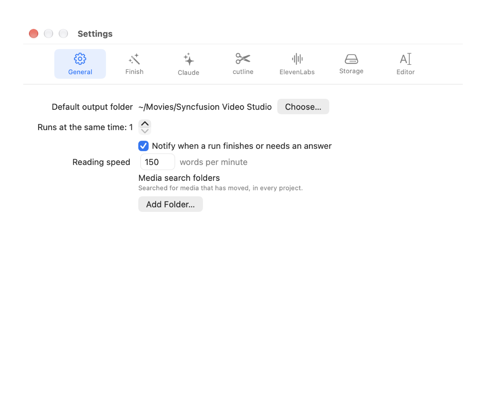

| Setting | Default | What it does |
|---|---|---|
| Default output folder | `~/Movies/Syncfusion Video Studio` | Where run folders go, in a subfolder per project |
| Runs at the same time | 1 (max 4) | Runs of different projects that may go at once |
| Notify when a run finishes or needs an answer | On | System notifications |
| Reading speed | 150 words per minute | Used to check that narration fits |
| Media search folders | none | Where to look for moved media, in every project |

### Finish

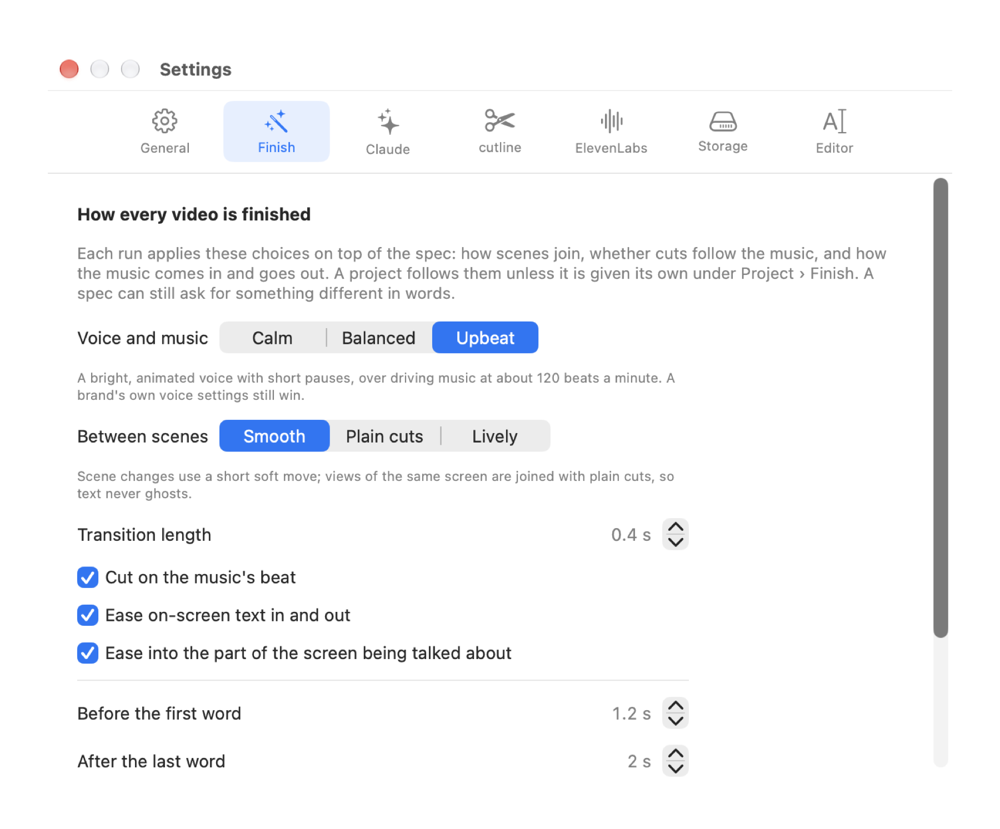

How every video is finished. A project follows these unless Project › Finish is *This project's own*. They're given to Claude as instructions, and the spec or brand rules can ask for something different.

| Setting | Default | Options |
|---|---|---|
| Voice and music | **Upbeat** | *Calm* (≈85–100 BPM), *Balanced* (≈100–115), *Upbeat* (≈118–126, an animated read with short pauses) |
| Between scenes | Smooth | Smooth, Plain cuts, Lively |
| Transition length | 0.4 s | 0.15–1.5 s (hidden for plain cuts) |
| Cut on the music's beat | On | |
| Ease on-screen text in and out | On | |
| Ease into the part of the screen being talked about | On | Smooth zooms toward what the narration mentions |
| Before the first word | 1.2 s | Lead-in |
| After the last word | 2 s | Hold at the end |
| Music fades in over / out over | 1 s / 2 s | |

### Claude

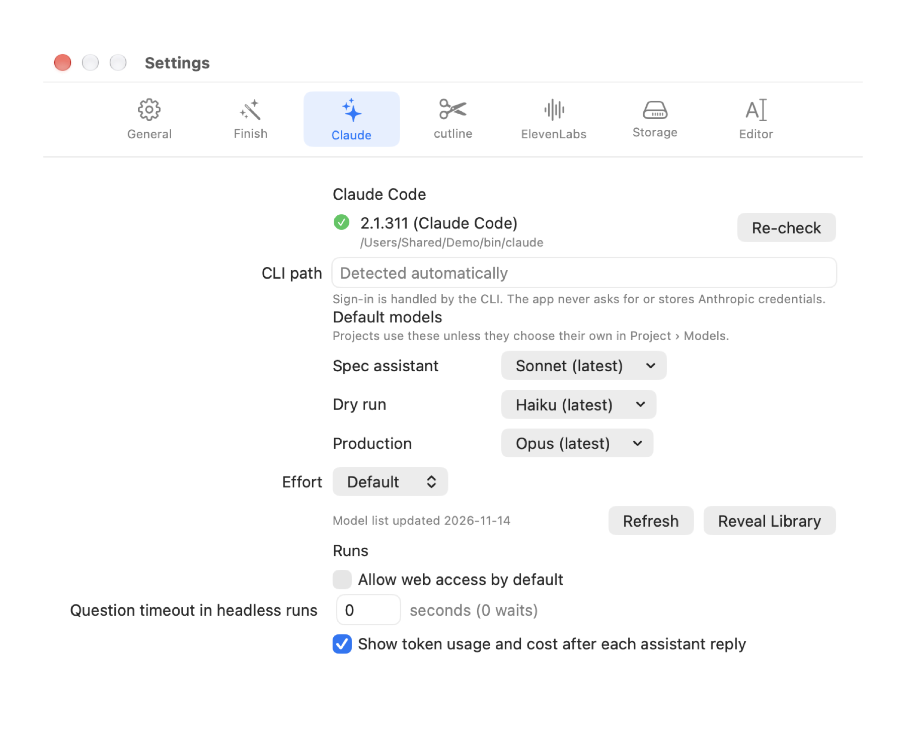

- **Claude Code** status: version, path and sign-in state, with a *Re-check* button. *CLI path* overrides the detected path.
- **Default models:**
  - **Spec assistant:** Sonnet.
  - **Dry run:** Haiku.
  - **Production:** Opus.
  - **Effort:** offered if your Claude Code supports it.
  - Each picker offers a family's *Latest*, a specific version, or *Custom ID…*. *Refresh* updates the model list.
- **Runs:**
  - *Allow web access by default*: off.
  - *Question timeout in headless runs*: 0, meaning wait.
  - *Show token usage and cost after each assistant reply*.

### cutline

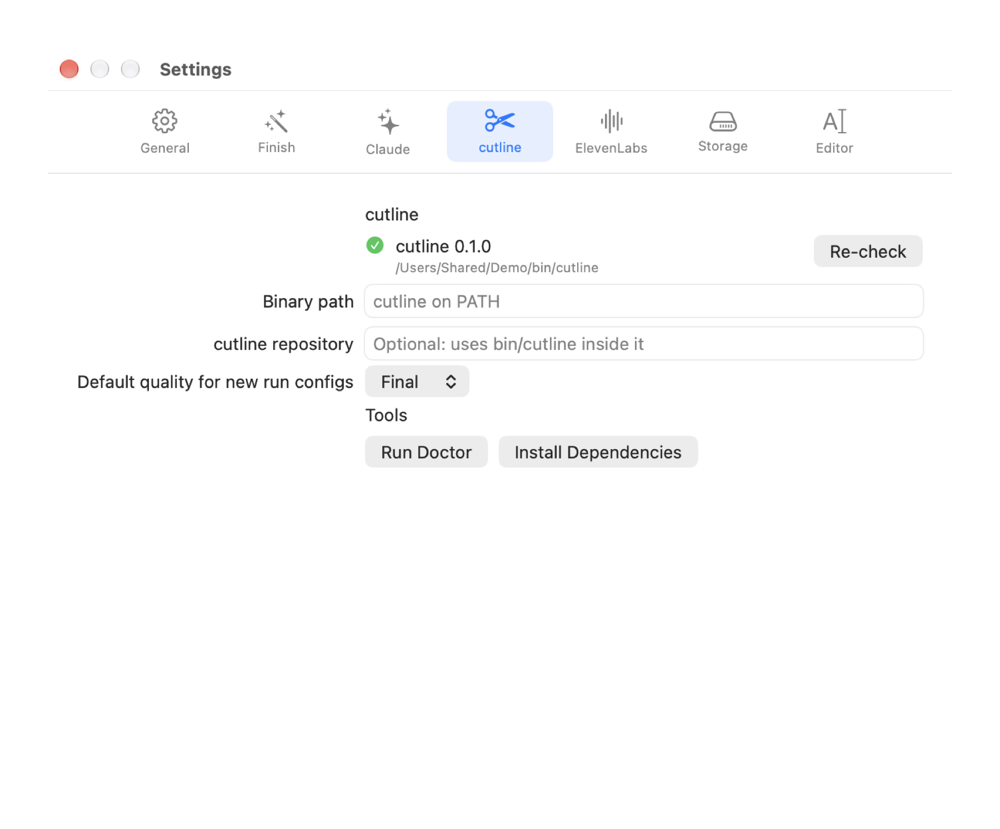

- **Status:** version, path, and missing or optional tools, with *Re-check*.
- **Paths:** *Binary path*, and *cutline repository* (uses `bin/cutline` inside it).
- **Default quality for new run configs:** Final or Draft.
- **Tools:** *Run Doctor*, and *Install Dependencies*, which runs `cutline deps install --all`.

### ElevenLabs

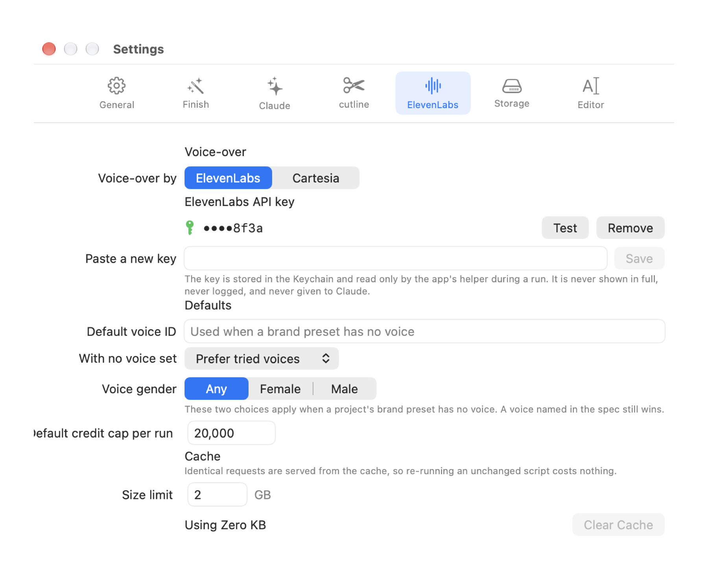

- **Voice-over by:** ElevenLabs or Cartesia, each with its key and voice ID.
- **ElevenLabs API key:** paste it and **Save**, then use **Test** (it shows your remaining credits) or **Remove**.
  - The key is kept in the macOS Keychain and read only by the helper during a run. It is never shown in full, logged, or given to Claude.
- **Defaults:**
  - *Default voice ID*.
  - *With no voice set*: tried or latest voices.
  - *Voice gender*.
  - *Default credit cap per run*: 20,000.
- **Cache:** size limit (2 GB) and *Clear Cache*.

### Storage

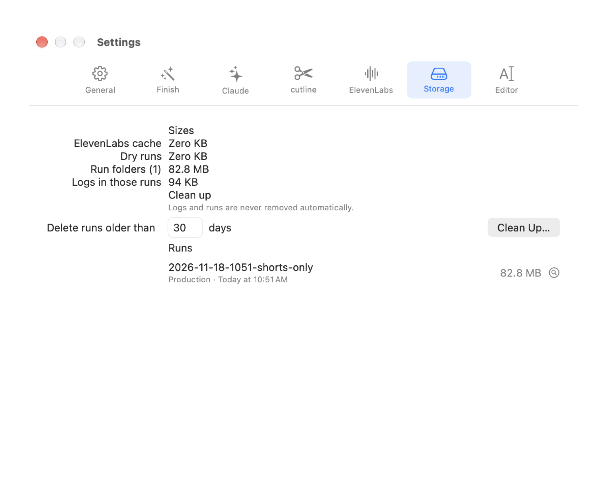

- Sizes of the ElevenLabs cache, dry runs, run folders and logs.
- **Delete runs older than N days** (default 30) with **Clean Up…**. It asks first and can't be undone.
- A list of recent runs with reveal buttons.

### Editor

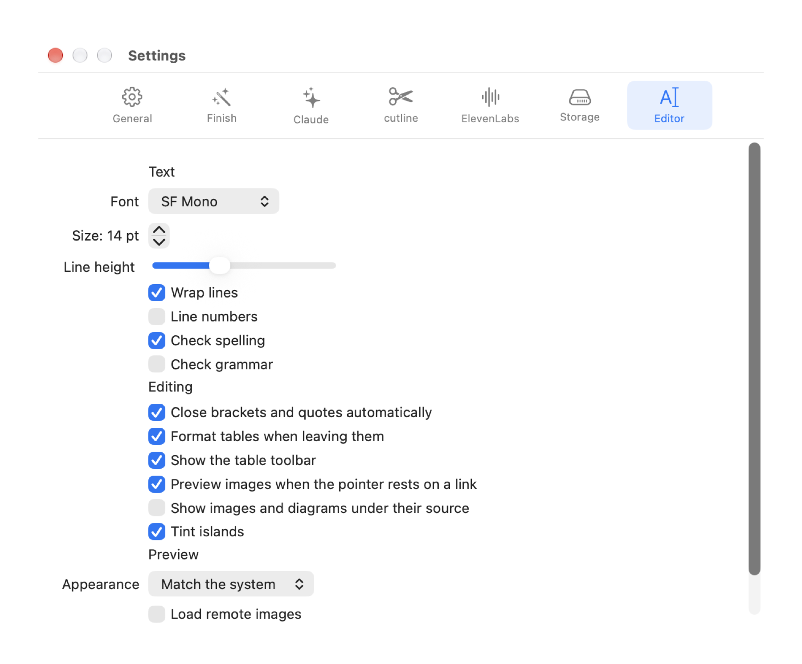

- **Text:**
  - *Font*: SF Mono, System, Menlo or Courier New.
  - *Size*: 14 pt.
  - *Line height*: 1.35.
  - On by default: *Wrap lines*, *Check spelling*.
  - Off by default: *Line numbers*, *Check grammar*.
- **Editing:**
  - On by default: auto-close brackets and quotes, format tables when leaving them, the table toolbar, image previews on hover, tinted islands.
  - Off by default: *Show images and diagrams under their source*.
- **Preview:**
  - *Appearance*: match the system, Light or Dark.
  - *Load remote images*: off, for privacy.
  - *Outline islands*.

---

## 17. Keyboard shortcuts

| Action | Keys | Action | Keys |
|---|---|---|---|
| New Project | ⌘N | Validate | ⇧⌘V |
| Open | ⌘O | Dry Run | ⌥⌘R |
| Save / Save As | ⌘S / ⇧⌘S | Run / Stop | ⌘R / ⌘. |
| Add Media | ⇧⌘I | Gather Missing Info | ⌃⌘G |
| Export Spec | ⇧⌘E | New Claude Session | ⇧⌘N |
| Settings | ⌘, | Send to Claude | ⌘Return |
| App Library | ⇧⌘L | Source / Preview | ⌘/ |
| Bold / Italic | ⌘B / ⌘I | Outline / Media / Runs | ⌃⌘1 / 2 / 3 |
| Strikethrough | ⇧⌘X | Claude / Project / Outputs | ⌥⌘1 / 2 / 3 |
| Inline Code / Link | ⌘E / ⌘K | Validation / Run | ⌥⌘4 / 5 |
| Heading 1–6 / Paragraph | ⌘1–⌘6 / ⌘0 | Find / Replace | ⌘F / ⌥⌘F |
| Numbered / Bulleted / Task list | ⇧⌘7 / 8 / 9 | Find Next / Previous | ⌘G / ⇧⌘G |
| Quote / Code Block | ⇧⌘. / ⌥⌘C | Insert Island | ⌥⌘I |
| Horizontal Rule | ⇧⌘- | Insert Table / Format Table | ⌃⌥⌘T / ⌥⌘T |
| Indent / Outdent | ⌘] / ⌘[ | Move Line Up / Down | ⌥⌘↑ / ⌥⌘↓ |
| Full Screen | ⌃⌘F | Help | ⌘? |

Formatting shortcuts apply while the spec editor has focus.

In the `/` command list: ↑/↓ to move, Return or Tab to choose, Esc to close.

---

## 18. Where things are stored

| What | Where |
|---|---|
| A project | One `.cutproj` file wherever you saved it |
| Pasted images | `<project>.cutproj.assets/` next to the project |
| Settings, brand and output presets, templates, assistant sessions | `~/Library/Application Support/Syncfusion Video Studio/` (*Reveal Library* in Settings › Claude) |
| ElevenLabs and Cartesia keys | macOS Keychain |
| Runs | `<output folder>/<project>/<yyyy-mm-dd-hhmm>-<run config>/` |

A run folder holds everything needed to understand the run afterwards:

```
<run folder>/
  spec.md  brand-preset.json  outputs.json  media-manifest.json    what the app gave Claude
  project.json5  summary.md  audio/  captures/  review/           what Claude made
  outputs/<output>/<name>.mp4   (+ .srt .vtt .qa.json .poster.jpg)
  logs/                         every log, prompt and decision
```

The `video-studio` command-line tool reads the same settings and projects; see [README.md › The CLI](README.md#the-cli).

---

## 19. Troubleshooting

| Problem | What to do |
|---|---|
| "Claude Code isn't signed in" | Run `claude` in Terminal and sign in, then click *Re-check* (Settings › Claude) |
| "cutline is missing required tools" | Settings › cutline › *Install Dependencies* (takes a few minutes), or `cutline deps install --all` |
| The run is blocked by the ElevenLabs key or credits | Settings › ElevenLabs: save and *Test* the key; raise the run's credit cap in Outputs › Limits |
| **Test** says "ElevenLabs returned 401 … missing the permission user_read" | The key is valid but limited to some permissions, and can't read the account's credits. Voice-over and music still work if the key has those permissions. To see credits, edit the key at elevenlabs.io › API keys and allow **User › Read**. |
| Media shows *Missing* | File › *Relink Media…*; add search folders for where your media lives |
| The voice-over is too long for a scene | Ask Claude to *Tighten the script to the target length*, or lengthen the scene's Duration |
| App recording fails, or nothing is recorded | Check the Project tab's permission rows; allow Screen Recording and Accessibility, then *Re-check* |
| You must allow permissions again after every build | The app is ad-hoc signed. Sign it with your certificate (README › Signing). |
| "The run reached its Claude spend limit" | Raise *Claude spend limit* in Outputs › Limits, or use Draft quality or a cheaper model |
| The run stops at a question | Answer it in the Run tab, or set a *Question timeout* in the run config |
| Something went wrong and you need help | **Export Logs…** (with placeholders ticked) and send the zip, or paste **Copy Issue Report** into an issue |
