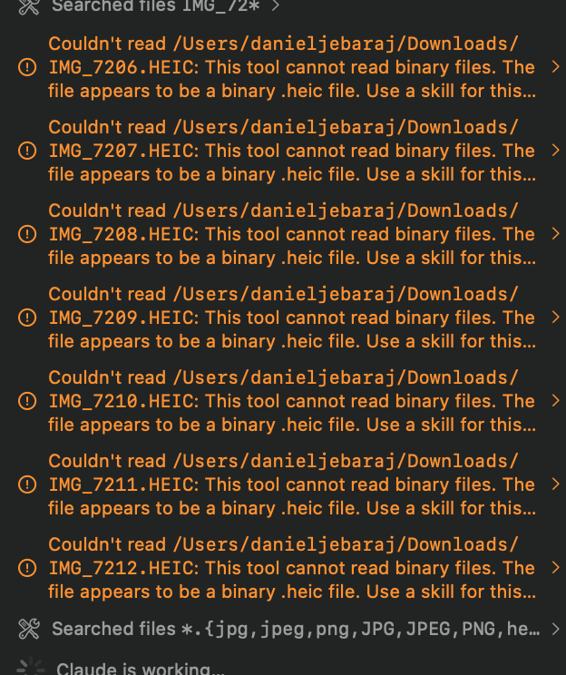

# HEIC not working

## Summary

I get the same error as before

The spec assistant (Claude tab) tries to open iPhone photos (`IMG_7206.HEIC` … `IMG_7212.HEIC` in `~/Downloads`) with Read, and every attempt fails with "This tool cannot read binary files. The file appears to be a binary .heic file."

## Steps to reproduce

1. Put some HEIC photos in a folder, for example `~/Downloads/IMG_7206.HEIC` … `IMG_7212.HEIC`.
2. In a project, add one file from that folder as media (so the folder becomes a media folder the assistant may read), or share the folder with the assistant with the Folders button. Don't add the HEIC photos themselves as media.
3. In the Claude tab, ask the assistant to use the photos `IMG_7206`–`IMG_7212` in the spec.

## Expected result

Claude can see the photos and describe or place them.

## Actual result

Claude finds the files with Glob and calls Read on each `.HEIC`; Read refuses binary files, and Claude has no other way to see them.

## Cause

FEAT-0004 made JPEG copies (`media-previews/<media-id>.jpg`) only for HEIC/HEIF photos in the project's media list, and the spec assistant could not run any command, so a HEIC that is only in a media or reference folder could never be opened. Production and dry runs could run cutline but not `cutline still`. Read's binary check runs before the permission hook, so the hook can't redirect Read to a copy.

## Fix

- [x] The spec assistant may run exactly one command, `cutline still <photo> --out photo-copies/<name>.jpg [--max-side N] [--quality Q]`: the photo must be in a folder it may read, the copy must go to `photo-copies/` in its session folder; any other command, cutline subcommand or output path is denied by the broker (`crates/video-studio-core/src/claude/broker.rs`).
- [x] The assistant gets the Bash tool and the cutline path whenever cutline is found (`crates/video-studio-ffi/src/lib.rs` always looks it up now; `crates/video-studio-core/src/assistant.rs`).
- [x] The assistant's system prompt tells Claude not to Read a HEIC/HEIF outside the media list but to make a copy with the exact `cutline still` command and Read the copy; without cutline it says such files can't be opened and to ask the user to add them as media.
- [x] Production and dry runs may run `cutline still` too (input must be readable, output inside the run folder), and the run prompt has the same instruction.
- [x] Tests: `assistant_may_copy_heic_photos_with_cutline_still`, `runs_may_copy_heic_photos_with_cutline_still` (broker), `assistant_prompt_heic_on_demand` (prompt).
- [x] Verified in the macOS app with real iPhone photos (steps above) — needs a Mac.

## Implementation log

### 2026-11-19
- Implemented: approved in chat by the owner ("Please approve the HEIC bug and work"). All fix steps above except the check on a Mac.
- Not done: verification in the macOS app with the steps to reproduce.
- Files: crates/video-studio-core/src/claude/broker.rs, crates/video-studio-core/src/assistant.rs, crates/video-studio-core/src/run/prompt.rs, crates/video-studio-core/src/viewable.rs, crates/video-studio-ffi/src/lib.rs
- Commit/PR: see the commit "Fix BUG-0001" on branch claude/exciting-galileo-9qdsf5

### 2026-11-19
- Implemented: closed as verified. The owner confirmed the fix ("mark the three fixed bugs as done"; `verified: yes` was already set), so the macOS check is ticked on their word.
- Not done: nothing.
- Files: none (planner item only)
- Commit/PR: none
