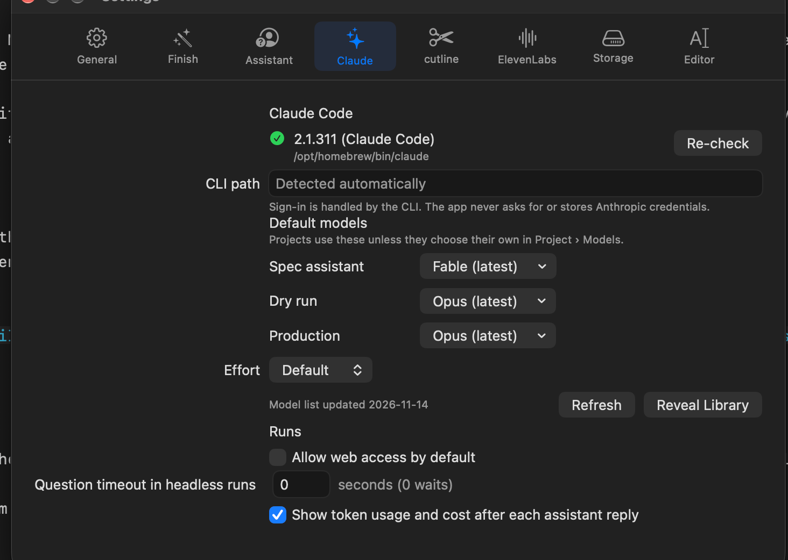
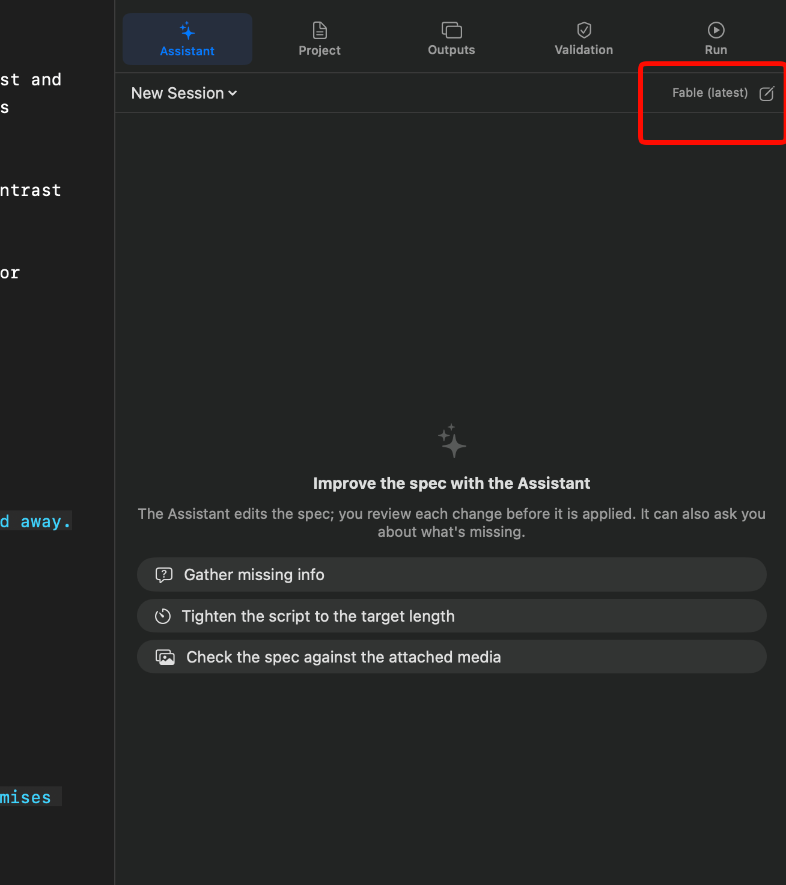

# Codex settings not correct

## Summary

On macOS, Settings shows Codex selected and ready, yet an existing project's production model menu still offers Claude models and the Assistant's new-session header shows Fable. Provider selection and provider configuration also have inconsistent homes in Settings.

Setting is set to Codex. But there is another tab for Claude. Assistant setting (which assistant to use) should be clearly separate from settings for Claude and Codex.

The project never picked up Codex.

The instruction window also did not even though assistant is set to Codex.

## Steps to reproduce

1. Open a project with a named run config such as Test. Set its Claude production model to Opus and its assistant model to Fable, or use project defaults that resolve to those models.
2. With the project open, choose Codex under Settings › Assistant. Configure a signed-in Codex executable, select Codex default and confirm that Re-check reports ready. The reported installation used `/opt/homebrew/bin/codex`.
3. Open Outputs › Test › Production and expand Model. Open Assistant › New Session and inspect the model beside the session title.

## Actual result

Codex configuration appears inside Assistant while Claude has a dedicated Settings tab. The production picker shows Opus (latest) and offers Fable, Opus, Sonnet and Haiku. The new-session header shows Fable (latest). The screenshots establish the displayed values. The executable and model used for an actual operation still require verification.

## Expected result

Settings › Assistant selects the app-wide provider. Settings › Claude and Settings › Codex each contain that provider's executable, readiness and model preferences. Opening either configuration pane does not activate it. Every open project shows the effective model for its next operation. With Codex default selected and no Codex override, both affected surfaces show “Codex default”.

## Fix steps

- [ ] Separate the three Settings destinations in `apps/macos/Sources/VideoStudio/Views/SettingsView.swift` and the corresponding Windows Settings UI. Retain saved paths, model choices and the active provider when loading existing settings.
- [ ] Make the model picker and new-session header in `ClaudePanel.swift`, and the project and production pickers in `InspectorViews.swift`, resolve choices from the active provider. Apply the same behavior to the corresponding Windows project controls. Populate Codex choices from its model list with an explicit Codex default option, including when the list is empty.
- [ ] Use consistent model precedence for display and dispatch: an applicable override for the active provider, its saved default, then its CLI default. Treat legacy Claude overrides as Claude-specific. Keep them available when switching back. Trace assistant dispatch in `crates/video-studio-ffi/src/lib.rs` and run preparation in `crates/video-studio-core/src/run/prepare.rs` so a visible choice takes effect.

## Verification

- [ ] Repeat the reproduction with two open projects. Switch providers without reopening either project. Check the Outputs picker, Project model controls and new Assistant session in each. Switch back to Claude and verify the original Fable and Opus choices return.
- [ ] Use the fake Codex app server with Claude unavailable. Start an assistant turn and a production run from Test. For Codex default, verify the outbound requests delegate model selection to Codex. Repeat with an explicit model from the fake catalog and verify its exact ID reaches the server for the corresponding operation.
- [ ] Restart with Codex selected. Verify the provider choice, provider-specific overrides and both Settings panes persist. Opening Claude settings leaves the next assistant turn on Codex. Verify these flows on macOS and Windows.

## Design notes

This is a regression against the app-wide provider behavior in FEAT-spry-alpaca-5RQZ. The captured Codex readiness check succeeded. Reproduce with a ready provider to isolate the model display and selection paths from executable discovery.

## Implementation log

### 2026-11-22

- Implemented: Documented the reported behavior, reproduction steps and model-dispatch checks.
- Not done: Runtime reproduction, fix and verification await approval.
- Files: This bug README.md.

