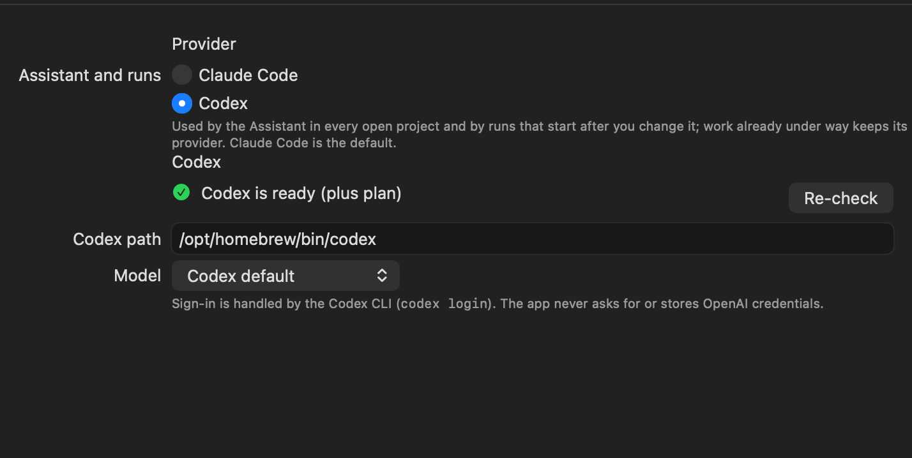
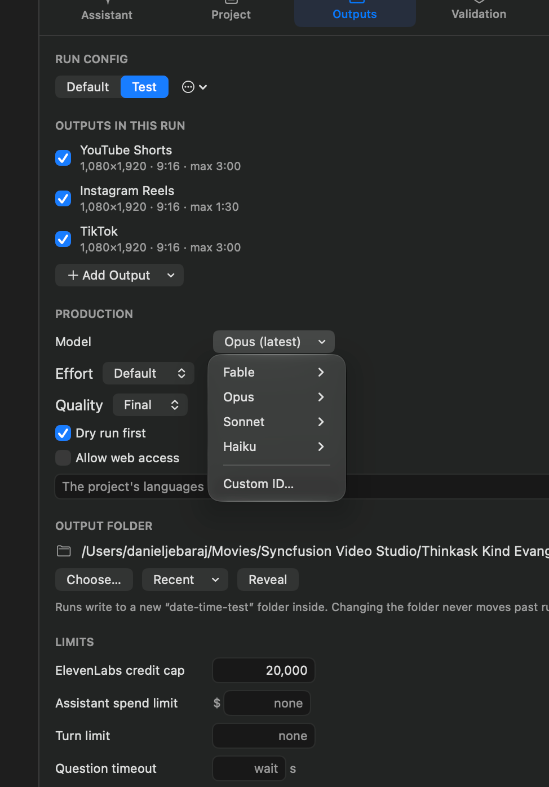

# Codex settings not correct

## Summary

On macOS, Settings shows Codex selected and ready, yet an existing project's production model menu still offers Claude models and the Assistant's new-session header shows Fable. Provider selection and provider configuration also have inconsistent homes in Settings.

Setting is set to Codex. But there is another tab for Claude. Assistant setting (which assistant to use) should be clearly separate from settings for Claude and Codex.

The project never picked up Codex.

The instruction window also did not even though assistant is set to Codex.

## Steps to reproduce

1. Open a project with a named run config such as Test. Set its Claude production model to Opus and its assistant model to Fable, or use project defaults that resolve to those models.
2. With the project open, choose Codex under Settings › Assistant. Configure a signed-in Codex executable, select Codex default and confirm that Re-check reports ready. The reported installation used `/opt/homebrew/bin/codex`.
3. Open Outputs › Test › Production and expand Model. Open Assistant › New Session and inspect the model beside the session title.

## Actual result

Codex configuration appears inside Assistant while Claude has a dedicated Settings tab. The production picker shows Opus (latest) and offers Fable, Opus, Sonnet and Haiku. The new-session header shows Fable (latest). The screenshots establish the displayed values. The executable and model used for an actual operation still require verification.

## Expected result

Settings › Assistant selects the app-wide provider. Settings › Claude and Settings › Codex each contain that provider's executable, readiness and model preferences. Opening either configuration pane does not activate it. Every open project shows the effective model for its next operation. With Codex default selected and no Codex override, both affected surfaces show “Codex default”.

## Fix steps

- [ ] Separate the three Settings destinations in `apps/macos/Sources/VideoStudio/Views/SettingsView.swift` and the corresponding Windows Settings UI. Retain saved paths, model choices and the active provider when loading existing settings.
  - [x] macOS, seen in the running app: Settings › Assistant has only the provider, and Settings › Claude and Settings › Codex each have their executable, readiness and models. Opening the Codex pane with Claude selected left the provider on Claude, and a restart kept the provider and both panes' values.
  - [ ] Windows.
- [ ] Make the model picker and new-session header in `ClaudePanel.swift`, and the project and production pickers in `InspectorViews.swift`, resolve choices from the active provider. Apply the same behavior to the corresponding Windows project controls. Populate Codex choices from its model list with an explicit Codex default option, including when the list is empty.
  - [x] macOS labels, seen in the running app: the Assistant header, Project › Models (Spec assistant, Dry run) and Outputs › Production show "Codex default" under Codex, and Fable, Settings default (Haiku) and Opus under Claude. Both open project windows update on a switch without reopening.
  - [ ] macOS Codex menu contents (the model list, an empty list): not opened, because menus can't be opened in background control.
  - [ ] Windows.
- [x] Use consistent model precedence for display and dispatch: an applicable override for the active provider, its saved default, then its CLI default. Treat legacy Claude overrides as Claude-specific. Keep them available when switching back. Trace assistant dispatch in `crates/video-studio-ffi/src/lib.rs` and run preparation in `crates/video-studio-core/src/run/prepare.rs` so a visible choice takes effect.

## Verification

- [ ] Repeat the reproduction with two open projects. Switch providers without reopening either project. Check the Outputs picker, Project model controls and new Assistant session in each. Switch back to Claude and verify the original Fable and Opus choices return.
  - [x] macOS: two projects open, Claude → Codex → Claude → Codex without reopening either. Every surface showed the effective model each time, and Fable and Opus came back on Claude. Both project files kept `assistant: fable` and `production_model: opus`.
  - [ ] Windows.
- [x] Use the fake Codex app server with Claude unavailable. Start an assistant turn and a production run from Test. For Codex default, verify the outbound requests delegate model selection to Codex. Repeat with an explicit model from the fake catalog and verify its exact ID reaches the server for the corresponding operation.
- [ ] Restart with Codex selected. Verify the provider choice, provider-specific overrides and both Settings panes persist. Opening Claude settings leaves the next assistant turn on Codex. Verify these flows on macOS and Windows.

## Design notes

This is a regression against the app-wide provider behavior in FEAT-spry-alpaca-5RQZ. The captured Codex readiness check succeeded. Reproduce with a ready provider to isolate the model display and selection paths from executable discovery.

The fix adds a Settings › Codex pane and narrows Settings › Assistant to the provider choice. `ui/spec.md` §18 lists the Settings panes and doesn't yet mention Assistant or Codex; update it when the spec is next revised.

## Implementation log

### 2026-11-22

- Implemented: Documented the reported behavior, reproduction steps and model-dispatch checks.
- Not done: Runtime reproduction, fix and verification await approval.
- Files: This bug README.md.

### 2026-11-22 — Desktop: Settings panes and provider-aware model pickers

- Implemented (macOS and Windows, code only; no fix-step box is checked because the behavior hasn't been observed in the running apps):
  - Settings: Settings › Assistant now holds only the app-wide provider choice (Claude Code / Codex) with a short explanation. Settings › Claude is unchanged. A new Settings › Codex pane has the Codex path, readiness with Re-check (finding title and remedy), and the default Codex model ("Codex default" plus the models from `codex.check`, including when the list is empty). Opening either provider pane doesn't change the provider; the Codex pane checks Codex even while Claude is selected (the readiness check now keeps its answer regardless of the provider, still dropping stale answers by generation). Setup links for a missing Codex (Welcome/Start checklist, project overlay, Assistant panel) open Settings › Codex.
  - Model pickers follow the active provider: macOS `ProviderModelPicker`/`CodexModelPicker` (`Views/ClaudePanel.swift`) in Project › Models (spec assistant, dry run) and Outputs › run config › Production (`Views/InspectorViews.swift`); Windows `providerModelPicker`/`codexModelPicker` (`widgets.ts`) in `project/inspector/project.ts` and `project/inspector/outputs.ts`. Under Codex they offer an explicit empty choice ("Codex default", or "Settings default (…)" when Settings › Codex names a model), Codex's model list and a custom ID, bound to `codex_assistant`, `codex_dry_run` and `codex_production_model`; under Claude they are today's Claude menus bound to the Claude fields, which are kept while Codex is selected. The views re-render on settings and Codex status changes, so every open project window follows a provider switch without reopening.
  - Labels: the Assistant header (new session) and the run sheet's dry-run line show the effective model computed with the same precedence as the core's `models.effective` (`Model/ModelResolution.swift` on macOS, `src/model-resolution.ts` on Windows), so Codex with nothing chosen shows "Codex default", never Claude's model.
  - Dispatch: assistant turns send `codex_model` = the project's `codex_assistant` (when set; Claude's `model` is sent as before). Run confirmation and Audio Review sheets under Codex show a Codex model picker starting at the run config's Codex model; a different choice is sent as the run's `codex_model`, never as `model`. Claude runs are unchanged.
  - macOS `ProjectModels` and `RunConfig` (`Core/Models.swift`) decode and write `codex_assistant`, `codex_dry_run` and `codex_production_model` (empty values omitted, as the core writes them), so saving from the Mac app no longer drops them.
  - Core text only: Codex path remedies now point at Settings › Codex, and the Codex validation finding's fix link targets the `codex` Settings pane (`codex.rs`, `run/prepare.rs`, `validation.rs`, one FFI test assertion). User guide updated for the new panes.
- Verified: `cargo test -p video-studio-core -p video-studio-ffi` and `cargo test -p video-studio-cli --test codex_ffi --test codex_runs --test e2e_tools` pass; macOS `VS_SKIP_CUTLINE=1 ./build.sh debug` builds; Windows UI `npm run build` (type-check and bundle) passes. The pure resolution and label logic was checked outside the apps: `ModelResolution.swift` compiled with a scratch test harness (Claude and Codex precedence, overrides, labels) and `model-resolution.ts` run under Node against the same cases as the core's unit test. New in-app self-test checks compare the local resolution with FFI `models.effective` for both providers (macOS `SelfTest.modelResolutionChecks`, Windows step "model resolution"); they were not run.
- Not observed: neither app was run. The Settings panes, picker contents and labels, live updates across two open project windows on a provider switch, the run sheet's Codex picker, and the outbound Codex requests are unverified in the GUIs; the Verification boxes remain open.
- Files: `apps/macos/Sources/VideoStudio/{Core/Models.swift, Model/ModelResolution.swift, Model/AppState.swift, Model/ProjectDocument.swift, Model/AssistantModel.swift, Model/RunController.swift, Views/SettingsView.swift, Views/ClaudePanel.swift, Views/InspectorViews.swift, Views/RunViews.swift, Views/ProjectRootView.swift, Views/WelcomeView.swift, App/SelfTest.swift}`; `apps/windows/ui/src/{model-resolution.ts, app-state.ts, widgets.ts, settings/settings.ts, project/inspector/project.ts, project/inspector/outputs.ts, project/inspector/claude.ts, project/assistant.ts, project/runs.ts, project/sheets.ts, start/start.ts, selftest.ts}`; `crates/video-studio-core/src/{codex.rs, validation.rs, run/prepare.rs}`; `crates/video-studio-ffi/src/lib.rs`; `docs/video-studio/USER_GUIDE.md`.

### 2026-11-22 — Core model precedence and dispatch

- Implemented: "Use consistent model precedence for display and dispatch".
  - Claude's fields stay Claude-only and are kept for switching back. New Codex fields hold Codex choices: `Models.codex_assistant`, `Models.codex_dry_run` and `RunConfig.codex_production_model`, left out when empty.
  - `project::effective_model` is the one precedence: an override for the active provider, then the project's or run config's choice for that provider, then that provider's Settings default, then its CLI default. For Codex, `None` means "Codex default".
  - Runs use it in `run::prepare`, with a separate per-run `RunRequest.codex_model`.
  - Assistant turns use it in FFI `start_assistant`, through `AssistantRequest.codex_model`.
  - The apps display it through FFI `models.effective`, or through local copies checked against it.
  - CLI `--model` overrides the selected provider's model.
  - The schema and the generated Windows types are regenerated.
- Verified ("Use the fake Codex app server with Claude unavailable"):
  - `video-studio-cli --test codex_runs a_codex_run_uses_codex_models_not_claudes` runs with `VIDEO_STUDIO_NO_CLAUDE=1`. A run config with Claude's `opus` and no Codex model sends no `model` in `thread/start` or `turn/start`. With `codex_production_model: gpt-5.5-codex`, that exact ID is sent, and `production_model` stays `opus`.
  - `--test codex_ffi`: a Codex assistant turn started through FFI with Claude absent sends no model for Codex default and `gpt-5.5-codex` when the project sets it. `models.effective` reports Codex default for a project whose Claude assistant model is Fable.
  - `project::tests::the_effective_model_follows_the_active_provider` covers precedence for both providers, switching back, and legacy JSON.
- Desktop: the fix steps for the Settings panes and the model pickers are in the entry above, built but not observed, so their boxes stay unchecked.
- Checks: all workspace tests pass, clippy is clean, the macOS debug build and the Windows UI build pass, and the Windows shell type-checks.
- Not done: the first and third Verification boxes need the running apps on macOS and Windows.
- Files: `crates/video-studio-core/src/{project.rs,run/prepare.rs,assistant.rs}`, `crates/video-studio-ffi/src/lib.rs`, `crates/video-studio-cli/src/main.rs`, `crates/video-studio-cli/tests/{codex_runs.rs,codex_ffi.rs,codex_assistant.rs,e2e_tools.rs}`, `schema/cutproj.schema.json`, `apps/windows/ui/src/generated/project.ts`.
- Commit/PR: `6f953b7` (core) and `5d23593` (desktop) on branch `fix-BUG-fond-crane-62ZP`.

### 2026-11-22 — macOS check in the running app

- Tested the debug build against a throwaway library and two copies of a test project (Claude assistant model Fable, production model Opus), with a ready Codex at `/opt/homebrew/bin/codex`. No assistant turns or runs were started.
- Seen working: the three Settings panes; opening the Codex pane doesn't select Codex; and the provider switching across two open windows, with the labels described in the sub-boxes above. After a restart with Codex selected, the provider stayed Codex and both projects still showed "Codex default". The in-app self test passed all 117 checks, including the two new model-resolution checks.
- Fixed: the explanation in Settings › Assistant ran past the window's right edge. Its captions now have a width limit (`SettingsView.swift`), and they wrap in the rebuilt app.
- Not checked:
  - the Codex menu contents
  - opening Settings › Claude while Codex is selected and then starting a turn
  - Windows
  - real outbound Codex requests from the app
- Commit/PR: "BUG-fond-crane-62ZP: wrap the Settings › Assistant captions; record the macOS check" on branch `fix-assistant-settings-wrap`.
