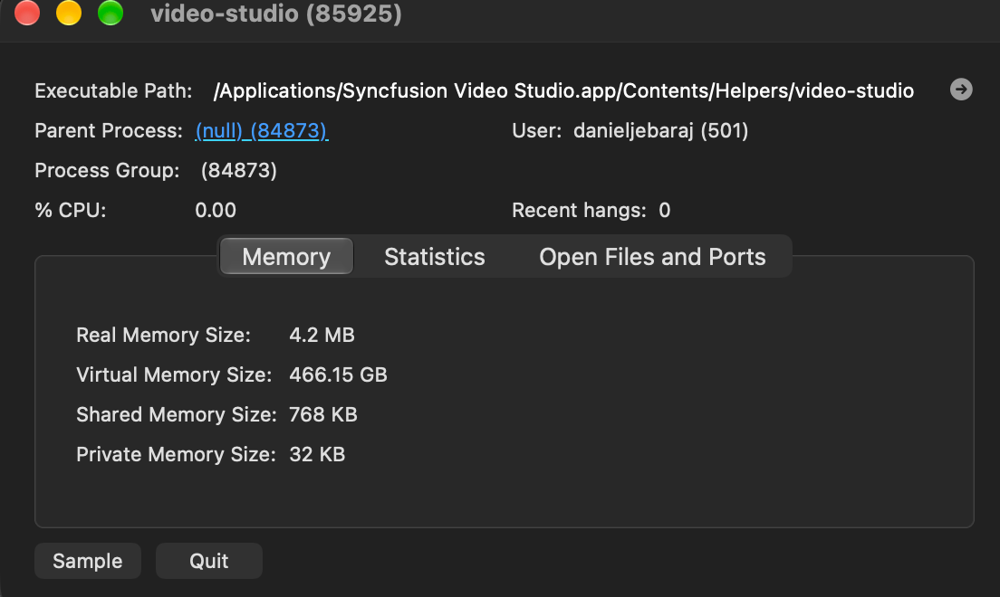
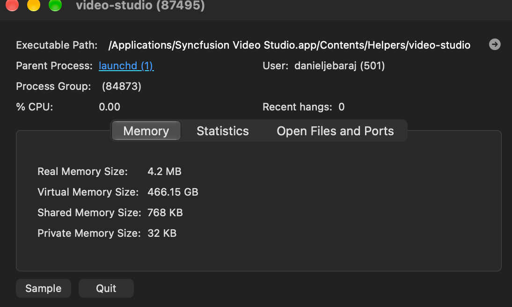

# Bundled video-studio helpers remain running after quitting the macOS app

## Summary

After the user exited Syncfusion Video Studio, Activity Monitor showed two processes from the installed app's `Contents/Helpers/video-studio` executable. Both showed 0.00% CPU and belonged to process group 84873. PID 85925 listed parent “(null) (84873)”; PID 87495 listed `launchd` (PID 1). The screenshots identify the executable but do not show its arguments, the operation that started it, the exit gesture or how long it persisted.

## Steps to reproduce

1. On macOS, record the baseline process list, launch the installed app, open a disposable project and record the GUI PID. Use `ps -axo pid,ppid,pgid,state,etime,command` to identify newly launched bundle helpers. Capture their arguments and parentage while the GUI is alive.
2. First quit with ⌘Q from an idle project. Repeat during a local fixture run that holds a bundled helper open long enough to observe it. Record the helper PID and any child PIDs before choosing **Stop and Quit**. Exercise the host relay path with a fake long-running helper if a real run finishes too quickly.
3. After the GUI exits, sample the same PIDs immediately and again after five seconds. Record whether they exited, became zombies or continued running under another parent. Repeat the active case with Cancel at the quit prompt as a control. Closing the last project window is a separate action: the app can return to its welcome window.

## Expected result

Quitting saves pending project edits. Confirming Stop and Quit stops work owned by that app instance, preserves partial outputs and logs, and reaps its helpers and their descendants. Cancel keeps the project and operation active. Independently launched CLI jobs continue.

## Actual result

The user observed two idle bundled helpers after exit, including one with parent PID 1. The responsible launch path and shutdown timing still require reproduction.

## Fix checklist

- [ ] Identify the surviving helper subcommand and its owner from a controlled reproduction. Trace `applicationShouldTerminate` in `apps/macos/Sources/VideoStudio/App/AppDelegate.swift` and `ProjectDocument.close()` in `Model/ProjectDocument.swift`. The current path saves, requests run and assistant stops, then returns `.terminateNow`. Establish whether cleanup finished before GUI exit. Inspect `crates/video-studio-core/src/run/relay.rs` if the surviving process came from its host-launched helper.
- [ ] Give the confirmed owner a bounded shutdown path. On confirmed quit, prevent new owned helpers from starting, request graceful cancellation, and terminate and reap remaining owned children after the grace period. Coordinate app termination with completion across open projects. Limit cleanup to process handles or groups the app created and owns.
- [ ] Add a macOS regression fixture with a helper that exits on cancellation and one that spawns a child and ignores graceful stop. Verify both paths finish within a documented shutdown deadline, leave no recorded fixture PIDs alive, and preserve a separately launched control process.
- [ ] Repeat idle Quit, active Stop and Quit, and Cancel in the packaged app. Verify pending edits persist on quit, partial run logs remain readable, cancellation leaves the active operation usable, and repeated quit/relaunch cycles do not accumulate helpers.

## Implementation log

### 2026-11-24

- Implemented: Documented the Activity Monitor evidence, shutdown paths to inspect and regression criteria.
- Not done: Controlled reproduction, root-cause confirmation, implementation and verification await approval.
- Files: This bug README.md.

